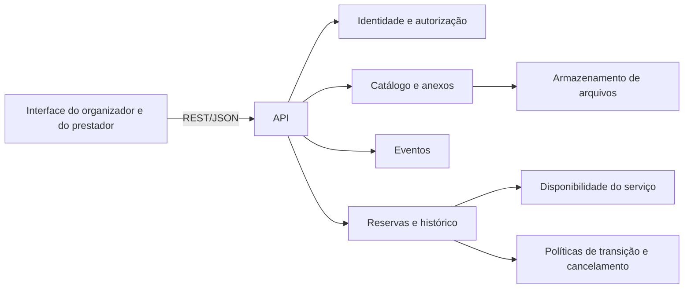
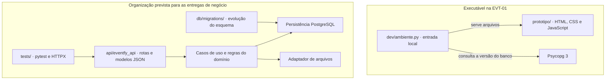
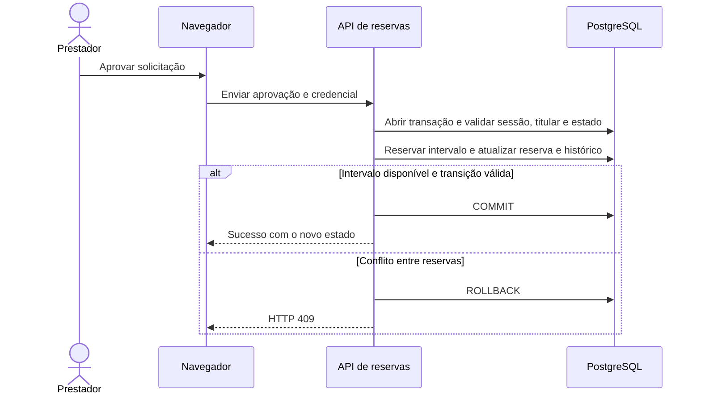
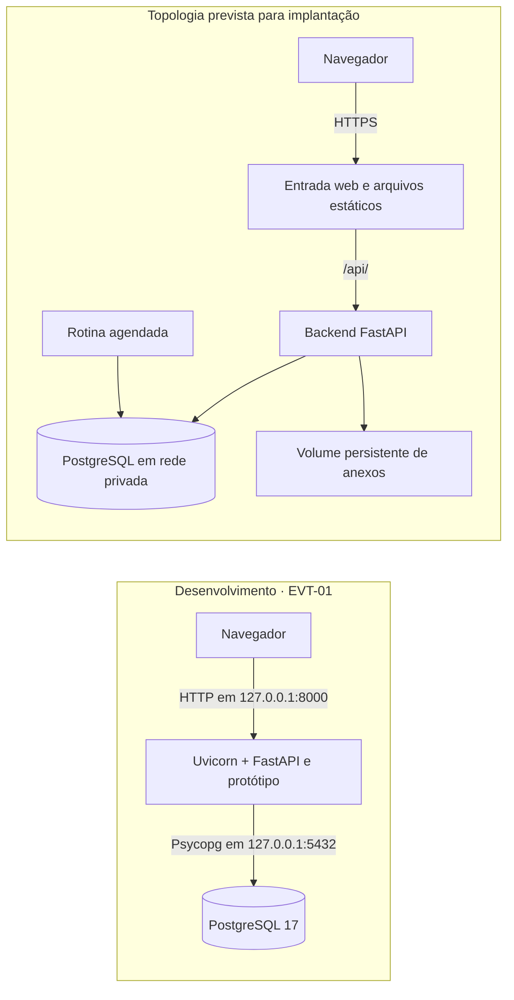

# Arquitetura do EventFy

**EVT-01 · Proposta para revisão da equipe.** O EventFy conecta organizadores a prestadores de serviços. A decisão que mais pesa na arquitetura é a aprovação de uma reserva. Se duas solicitações disputarem o mesmo intervalo de um serviço, apenas uma poderá ocupá-lo. Agenda, reserva e histórico precisam registrar o mesmo resultado.

O ambiente desta entrega serve o protótipo e expõe uma rota de diagnóstico que consulta o PostgreSQL. As vistas abaixo distinguem essa base executável dos módulos de negócio previstos nas próximas entregas. [Issue #21](https://github.com/dudanegreiro/EventFy/issues/21) · [Requisitos](./docs/REQUISITOS.md) · [Modelo de domínio](./docs/diagrams/modelo-dominio.md)

## Tecnologias e versões de referência

| Área | Escolha | Uso no projeto |
|---|---|---|
| Frontend | HTML Living Standard, CSS com Grid/Flexbox e JavaScript ECMAScript 2022 | Reaproveitar o protótipo. O navegador consome JSON com Fetch. A interface dispensa compilação e pode ser servida como arquivos estáticos. |
| API | Python 3.14, FastAPI 0.165.0 e Uvicorn 0.54.0 | Validar requisições, servir rotas HTTP e publicar o contrato OpenAPI. O ambiente local lê o arquivo de configuração com python-dotenv 1.2.4. |
| Persistência | PostgreSQL 17 e Psycopg 3.3.9 | Executar SQL parametrizado e transações. As migrações versionadas e os dados fictícios pertencem à EVT-02. |
| Autenticação | JWT Bearer com HS256, PyJWT 2.x (a partir de 2.10) e bcrypt pelo pgcrypto do PostgreSQL 17 | A EVT-04 implementa login, expiração e revogação de sessão. |
| Anexos | Sistema de arquivos em volume persistente, acessado por `pathlib` do Python 3.14 | Conservar os binários fora do banco e servir o conteúdo pela API. |
| Testes | pytest 8.4.x, HTTPX 0.28.x e PostgreSQL 17 | Testes de unidade para regras de domínio e testes de integração da API com banco isolado. O uso do mesmo SGBD permite testar conflitos reais de agenda. |

As dependências necessárias para iniciar a EVT-01 estão em [dev/requirements.txt](./dev/requirements.txt). As escolhas para banco, API e autenticação acompanham o trabalho das [EVT-02](https://github.com/dudanegreiro/EventFy/issues/22), [EVT-03](https://github.com/dudanegreiro/EventFy/issues/23) e [EVT-04](https://github.com/dudanegreiro/EventFy/issues/24).

## 1. Vista lógica

Identidade fornece o usuário e o papel. Cada operação de escrita verifica a propriedade do evento ou serviço. Reservas coordena a transição, verifica disponibilidade e registra o autor e a justificativa. A política de prazo fica no domínio para que uma mudança de 45 para 60 dias tenha um único ponto de alteração. Essas responsabilidades seguem os [critérios de isolamento do projeto](./docs/PROJETO.md).

## 2. Vista de desenvolvimento

O contrato entre o navegador e o backend é HTTP sob `/api/`. Para o ambiente inicial, `GET /api/ambiente` retorna 200 com a versão lida do PostgreSQL ou 503 quando a conexão falha. O contrato está disponível em `/openapi.json`. As telas do protótipo continuam usando dados de demonstração até a integração de cada fluxo com a API.

## 3. Vista de processos

A aprovação ilustra a fronteira transacional prevista para as EVT-03 e EVT-06. O conflito precisa ser decidido pelo banco mesmo quando duas requisições passam simultaneamente pela verificação inicial.

A rotina de expiração prevista no backlog reutiliza as mesmas regras de transição e histórico. O executor agendado e a requisição HTTP devem revalidar o estado dentro da transação para impedir que uma aprovação e uma expiração confirmem decisões incompatíveis. [Ciclo de vida da reserva](./docs/diagrams/estados-reserva.md)

## 4. Vista de implantação

O ambiente local precisa apenas de Python e PostgreSQL. Na topologia de implantação, a interface e a API compartilham uma origem pública e o banco recebe conexões internas. O agendador executa o código de domínio do backend. A escolha do provedor e a configuração de backup ficam para as entregas de operação. [Ambientes · EVT-33](https://github.com/dudanegreiro/EventFy/issues/53) · [Plataforma · EVT-34](https://github.com/dudanegreiro/EventFy/issues/54)

## Registro das decisões arquiteturais

### ADR-01 · Monólito modular

**Decisão.** Implantar uma API e organizar o código por identidade, catálogo, eventos e reservas. Manter regras voláteis, como prazos e disponibilidade, atrás de operações de domínio.

**Motivo e consequência.** A equipe consegue aprovar uma reserva e gravar agenda e histórico em uma única transação. Microsserviços exigiriam coordenar falhas entre serviços para essa mesma operação. Uma aplicação com regras concentradas nos handlers tornaria mudanças de prazo dependentes de cada rota. Com o monólito modular, os módulos compartilham a implantação e releases do backend são coordenados pela equipe.

### ADR-02 · PostgreSQL para dados transacionais

**Decisão.** Persistir entidades em PostgreSQL 17. Usar chaves estrangeiras, migrações SQL versionadas e transações para reserva, agenda e histórico. Representar o período por um intervalo e aplicar uma restrição de exclusão aos bloqueios ativos do mesmo serviço.

**Motivo e consequência.** A restrição protege a agenda inclusive sob concorrência (RNF-02). SQLite simplificaria a instalação, mas exigiria outra implementação e outro teste para a exclusão de intervalos. A equipe passa a manter um servidor local e usa a mesma família de banco na integração. [Modelo de dados](./docs/diagrams/modelo-dados.md) · [Restrições sobre intervalos no PostgreSQL](https://www.postgresql.org/docs/17/rangetypes.html#RANGETYPES-CONSTRAINT)

### ADR-03 · Anexos em volume persistente

**Decisão.** Gravar arquivos em diretório privado configurado por `LOCAL_DOS_ARQUIVOS`. O backend gera a chave de armazenamento, verifica titularidade no envio, valida o conteúdo e o tipo permitido (JPEG, PNG, WebP, PDF ou DOCX) e aplica o limite de 10.000.000 bytes. A tabela `ARQUIVO` guarda metadados e URL de acesso pela API (RF19 e RE-04).

**Motivo e consequência.** Guardar binários em colunas do banco contrariaria RE-04. Um serviço de objetos acrescentaria credenciais e provisionamento ao ambiente inicial. O volume atende à primeira implantação com uma instância do backend. A operação precisa incluir o volume no backup e remover arquivos órfãos se a gravação de metadados falhar. Múltiplas instâncias exigirão armazenamento compartilhado ou serviço de objetos.

### ADR-04 · Autenticação e autorização

**Decisão.** A API emite JWT Bearer assinado com HS256, com validade inicial de 30 minutos. O segredo vem de `CHAVE_SECRETA_JWT`. O identificador do token corresponde a uma sessão revogável no banco. Em rotas protegidas, a API valida assinatura e prazo, consulta a sessão e o usuário ativo e confere papel e propriedade do recurso. Senhas usam bcrypt com salt e custo 12 via pgcrypto (RNF-01 e RNF-07).

**Motivo e consequência.** Um token aceito apenas pela assinatura continuaria válido após o logout até expirar. A consulta da sessão permite revogação imediata ao custo de uma leitura por requisição protegida. Um provedor de identidade externo acrescentaria configuração e dependência de rede à demonstração acadêmica. A equipe fica responsável por proteger o segredo e transportar as credenciais por HTTPS na implantação.
