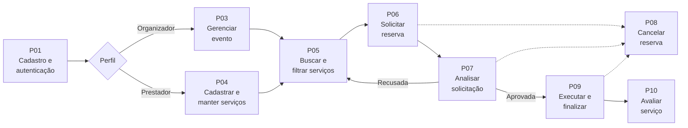
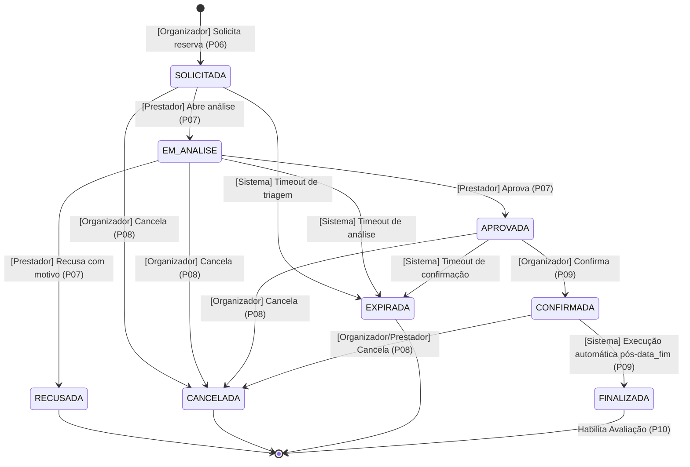

# 🔄 Processos de Negócio — EventFy

> Descrição detalhada dos processos de negócio da plataforma EventFy, cobrindo desde o cadastro do usuário até a avaliação do serviço contratado, totalmente reconciliada com [`REQUISITOS.md`](./REQUISITOS.md) e com os diagramas de modelagem.

---

## 1. Atores

| Ator | Papel nos processos |
|---|---|
| 🧑‍💼 **Organizador** | Cria e gerencia eventos, pesquisa catálogo, solicita, confirma e cancela reservas, avalia serviços finalizados. |
| 🏢 **Prestador** | Cadastra e mantém serviços, estrutura disponibilidades e bloqueios, analisa solicitações, aprova ou recusa com justificativa. |
| 🛡️ **Administrador** | Atividades administrativas, moderação e auditoria de conformidade. |
| 🖥️ **Sistema** | Executa validações automatizadas de disponibilidade, transições por timeout (expiração) e finalização de contratos pós-evento. |

---

## 2. Visão Geral (Macroprocesso)

### Mapeamento dos Processos com Requisitos

| ID | Processo | Ator principal | Requisitos Funcionais | Regras de Negócio | Requisitos Não Funcionais |
|---|---|---|---|---|---|
| **P01** | Cadastro de usuário | Visitante | RF01 | RN01 | RNF01, RNF04 |
| **P02** | Autenticação e perfil | Usuário | RF02, RF03 | RN01, RN02 | RNF01 |
| **P03** | Gerenciamento de eventos | Organizador | RF09, RF15 | RN01 | RNF04, RNF06 |
| **P04** | Cadastro e manutenção de serviços | Prestador | RF04, RF08 | RN02, RN06 | RNF04, RNF06 |
| **P05** | Busca e filtragem de serviços | Organizador | RF05, RF06, RF07 | RN02, RN06 | RNF03 |
| **P06** | Solicitação de reserva | Organizador | RF10 | RN01, RN03, RN06 | RNF02, RNF04 |
| **P07** | Análise e deliberação da solicitação | Prestador | RF11, RF12 | RN02, RN04, RN05 | RNF04, RNF05 |
| **P08** | Cancelamento de reserva | Organizador / Prestador | RF14 | RN05, RN07 | RNF05 |
| **P09** | Acompanhamento e finalização | Organizador / Prestador / Sistema | RF13, RF16, RF18 | RN05, RN07 | RNF05, RNF06 |
| **P10** | Avaliação do serviço | Organizador | RF17 | RN05 | RNF06 |

---

## 3. Processos Detalhados

### P01 — Cadastro de usuário

| Campo | Descrição |
|---|---|
| **Objetivo** | Criar uma conta de usuário para acesso à plataforma |
| **Ator** | Visitante |
| **Gatilho** | O visitante aciona a opção "Cadastre-se" |
| **Pré-condição** | Não possuir conta com o mesmo e-mail cadastrado (unicidade de credencial) |
| **Pós-condição** | Conta criada com papel definido e senha armazenada com hash criptográfico |
| **Requisitos** | RF01 · RN01 · RNF01 · RNF04 |

**Fluxo principal**
1. O visitante informa nome, e-mail, senha e tipo de usuário desejado (organizador ou prestador).
2. O sistema valida os campos obrigatórios, o formato do e-mail e a inexistência de conta com o mesmo e-mail (RF01).
3. O sistema gera o hash seguro da senha (RNF01) e persiste o usuário com status ativo (D02, D03).
4. O sistema direciona o usuário para a tela de autenticação com mensagem de sucesso.

**Fluxos alternativos**
- **2a. Dados inválidos ou incompletos:** O sistema indica os campos pendentes e retorna ao formulário.
- **2b. E-mail já cadastrado:** O sistema impede o cadastro (CA01.2) e orienta o usuário a efetuar login.

---

### P02 — Autenticação e Perfil

| Campo | Descrição |
|---|---|
| **Objetivo** | Autenticar o usuário, iniciar a sessão e permitir gerenciamento de dados cadastrais |
| **Ator** | Organizador, Prestador, Administrador |
| **Gatilho** | O usuário seleciona "Entrar" |
| **Pré-condição** | Possuir conta ativa no sistema |
| **Pós-condição** | Sessão segura iniciada com permissões de acesso específicas do perfil |
| **Requisitos** | RF02 · RF03 · RNF01 |

**Fluxo principal**
1. O usuário informa suas credenciais (e-mail e senha).
2. O sistema valida as credenciais confrontando o hash armazenado (RNF01).
3. O sistema inicializa a sessão e redireciona para a área correspondente ao papel do usuário.
4. O usuário pode consultar e atualizar seus dados no gerenciamento de perfil (RF03).

**Fluxos alternativos**
- **2a. Credenciais inválidas ou usuário inativo:** O sistema emite mensagem genérica de erro sem expor dados sensíveis e permite nova tentativa.
- **Logout:** O usuário pode encerrar sua sessão a qualquer momento (CA02.3).

---

### P03 — Gerenciamento de eventos

| Campo | Descrição |
|---|---|
| **Objetivo** | Cadastrar e gerenciar eventos para os quais serão contratados serviços |
| **Ator** | Organizador |
| **Gatilho** | O organizador decide planejar um evento |
| **Pré-condição** | Estar autenticado como organizador |
| **Pós-condição** | Evento registrado ou atualizado com datas e local no sistema |
| **Requisitos** | RF09 · RF15 · RN01 · RNF04 · RNF06 |

**Fluxo principal — criar evento**
1. O organizador escolhe "Criar Evento".
2. Preenche os dados obrigatórios: nome, descrição, `data_inicio`, `data_fim` (com suporte a hora, DATETIME) e local (RF09).
3. O sistema valida que `data_inicio <= data_fim` e vincula o evento exclusivamente ao organizador logado (RN01).
4. O evento é salvo com `ativo = true` e passa a constar na lista de eventos do organizador.

**Fluxos alternativos**
- **Editar evento:** O organizador altera dados permitidos; se houver reservas ativas, o sistema valida restrições.
- **Desativar/Cancelar evento:** O organizador desativa o evento (`ativo = false`); o sistema cancela as reservas ativas associadas disparando transições da máquina de estados (RF14, RN05).

---

### P04 — Cadastro e manutenção de serviços

| Campo | Descrição |
|---|---|
| **Objetivo** | Ofertar serviços no catálogo e gerenciar a disponibilidade e bloqueios da agenda |
| **Ator** | Prestador |
| **Gatilho** | O prestador deseja disponibilizar ou atualizar um serviço |
| **Pré-condição** | Estar autenticado como prestador |
| **Pós-condição** | Serviço publicado no catálogo com estrutura de disponibilidade configurada |
| **Requisitos** | RF04 · RF08 · RN02 · RN06 · RNF04 · RNF06 |

**Fluxo principal — cadastrar serviço**
1. O prestador seleciona "Novo Serviço".
2. Informa nome, categoria, descrição e preço (RF04).
3. Configura a estrutura de agenda e períodos de atendimento em `DISPONIBILIDADE_SERVICO` (Decisão DP02).
4. Opcionalmente, anexa fotos ou mídias que são salvas externamente com metadados em `ARQUIVO` (D07).
5. O sistema publica o serviço com `ativo = true`.

**Fluxos alternativos**
- **Bloqueio de agenda:** O prestador adiciona intervalos de indisponibilidade (`BLOQUEIO_MANUAL`) em `DISPONIBILIDADE_SERVICO`.
- **Desativação lógica:** O prestador desativa a oferta (`ativo = false`), removendo-o de novas buscas mas preservando reservas passadas (RF08, RN02).

---

### P05 — Busca e filtragem de serviços

| Campo | Descrição |
|---|---|
| **Objetivo** | Consultar, filtrar e comparar serviços para contratação |
| **Ator** | Organizador |
| **Gatilho** | Necessidade de contratar fornecedores para um evento |
| **Pré-condição** | Existir ao menos um serviço ativo cadastrado |
| **Pós-condição** | Serviço selecionado para abertura de solicitação |
| **Requisitos** | RF05 · RF06 · RF07 · RN02 · RN06 · RNF03 |

**Fluxo principal**
1. O organizador acessa o catálogo geral de serviços (RF05).
2. Informa termos de busca textual e aplica filtros de categoria e preço (RF06).
3. O sistema apresenta a listagem de itens compatíveis.
4. O organizador seleciona um serviço e visualiza a tela de detalhes com fotos, descritivo e preço (RF07).
5. O organizador avança para a solicitação de reserva (P06).

---

### P06 — Solicitação de reserva

| Campo | Descrição |
|---|---|
| **Objetivo** | Solicitar um serviço específico para um evento e período determinado |
| **Ator** | Organizador |
| **Gatilho** | O organizador clica em "Solicitar Reserva" na página do serviço |
| **Pré-condição** | Autenticado como organizador; possuir evento cadastrado; serviço ativo |
| **Pós-condição** | Reserva criada em estado `SOLICITADA` e histórico inicial registrado |
| **Requisitos** | RF10 · RN01 · RN03 · RN06 · RNF02 · RNF04 |

**Fluxo principal**
1. O organizador seleciona o evento de destino e informa o período solicitado (`dataInicio` e `dataFim`).
2. O sistema verifica as regras de disponibilidade em `DISPONIBILIDADE_SERVICO` para assegurar que não há sobreposição com bloqueios ou reservas confirmadas (RN06, RNF02).
3. O sistema cria a reserva com status inicial `SOLICITADA` (RF10, RN05).
4. O sistema gera a primeira entrada imutável em `HISTORICO_RESERVA` (RF18, RNF05).
5. O prestador responsável é notificado sobre a nova solicitação.

**Fluxos alternativos**
- **2a. Conflito de agenda:** O sistema detecta colisão de horários, bloqueia a criação e orienta a escolha de outro período ou prestador (RNF02).
- **Sem evento prévio:** O sistema orienta a criação do evento em P03 antes de prosseguir.

---

### P07 — Análise e deliberação da solicitação

| Campo | Descrição |
|---|---|
| **Objetivo** | Permitir que o prestador avalie a viabilidade técnica e aprove ou recuse a reserva |
| **Ator** | Prestador |
| **Gatilho** | Notificação de nova reserva no estado `SOLICITADA` |
| **Pré-condição** | Ser o prestador responsável pelo serviço solicitado (RN02) |
| **Pós-condição** | Reserva com status atualizado para `APROVADA` ou `RECUSADA` |
| **Requisitos** | RF11 · RF12 · RN02 · RN04 · RN05 · RNF04 · RNF05 |

**Fluxo principal — aprovação**
1. O prestador acessa a central de solicitações e abre o pedido.
2. O sistema altera o status para `EM_ANALISE` e grava o registro em `HISTORICO_RESERVA` (RF11, RF18).
3. O prestador analisa o evento e clica em "Aprovar Reserva".
4. O sistema verifica novamente a ausência de conflitos, muda o status para `APROVADA` e registra em `HISTORICO_RESERVA` (RF12).
5. O organizador é notificado para realizar a confirmação (RF13).

**Fluxo alternativo — recusa com motivo obrigatório (RN04)**
- **3a. Prestador decide recusar:** O prestador clica em "Recusar".
- O sistema exige obrigatoriamente o preenchimento de `motivo_recusa` (CA12.2, RN04).
- O sistema atualiza o status para `RECUSADA`, registra o motivo em `HISTORICO_RESERVA`, libera a agenda e notifica o organizador.

---

### P08 — Cancelamento de reserva

| Campo | Descrição |
|---|---|
| **Objetivo** | Encerrar uma reserva antes da prestação do serviço |
| **Ator** | Organizador ou Prestador |
| **Gatilho** | Necessidade operacional ou desistência justificada de uma das partes |
| **Pré-condição** | Reserva em estado `SOLICITADA`, `EM_ANALISE`, `APROVADA` ou `CONFIRMADA` |
| **Pós-condição** | Reserva em estado `CANCELADA` com histórico registrado e agenda liberada |
| **Requisitos** | RF14 · RN05 · RN07 · RNF05 |

**Fluxo principal**
1. O usuário autorizado acessa a reserva e aciona a opção "Cancelar Reserva".
2. O sistema verifica se a reserva está em um dos estados canceláveis (`SOLICITADA`, `EM_ANALISE`, `APROVADA` ou `CONFIRMADA`) (CA14.1, RN05).
3. O usuário confirma o cancelamento e informa a justificativa.
4. O sistema atualiza o status para `CANCELADA`, libera qualquer pré-reserva ou bloqueio em `DISPONIBILIDADE_SERVICO` e grava a transição em `HISTORICO_RESERVA` (RF18, RNF05).
5. O registro é mantido no banco de dados (exclusão lógica, Seção 10 do PROJETO.md).

---

### P09 — Acompanhamento, Confirmação e Finalização

| Campo | Descrição |
|---|---|
| **Objetivo** | Confirmar a reserva aprovada, acompanhar a execução e finalizar o contrato pós-evento |
| **Ator** | Organizador, Prestador e **Sistema** |
| **Gatilho** | Aprovação da reserva ou término do período (`data_fim`) |
| **Pré-condição** | Reserva em estado `APROVADA` ou `CONFIRMADA` |
| **Pós-condição** | Reserva confirmada pelo solicitante e posteriormente finalizada pelo sistema |
| **Requisitos** | RF13 · RF16 · RF18 · RN05 · RN07 · RNF05 · RNF06 |

**Fluxo principal**
1. O organizador recebe notificação da reserva `APROVADA` e clica em "Confirmar Contratação" (RF13).
2. O sistema comuta o estado para `CONFIRMADA`, consolida o bloqueio definitivo em `DISPONIBILIDADE_SERVICO` e registra em `HISTORICO_RESERVA`.
3. As partes acompanham o andamento em seus respectivos painéis (RF16).
4. **Finalização Automática pelo Sistema:** Decorrido o período do evento e ultrapassada a `data_fim` contratada, uma rotina do **Sistema** executa a transição para `FINALIZADA` e insere o registro em `HISTORICO_RESERVA` (RN05).
5. O sistema habilita o fluxo de avaliação para o organizador (P10).

---

### P10 — Avaliação do serviço

| Campo | Descrição |
|---|---|
| **Objetivo** | Registrar a avaliação qualitativa e nota do organizador sobre o serviço executado |
| **Ator** | Organizador |
| **Gatilho** | Conclusão do contrato (reserva no estado `FINALIZADA`) |
| **Pré-condição** | A reserva estar no estado `FINALIZADA` e ainda não ter sido avaliada (cardinalidade 1:0..1) |
| **Pós-condição** | Avaliação gravada e reputação do serviço atualizada no catálogo |
| **Requisitos** | RF17 · RN05 · RNF06 |

**Fluxo principal**
1. O organizador acessa a reserva finalizada e clica em "Avaliar Serviço".
2. Atribui uma nota inteira (1 a 5) e redige um comentário textual de feedback (RF17).
3. O sistema valida os campos, persiste o registro em `AVALIACAO` e associa à reserva e ao serviço.
4. A nota e o comentário passam a compor o histórico público de avaliações do catálogo.

---

## 4. Máquina de Estados da Reserva Consolidada

A máquina de estados que rege as transições da reserva está 100% alinhada a `estados-reserva.md` e `PROJETO.md`:

### Síntese de Responsabilidades por Estado

| Estado | Quem provoca a mudança | Efeito no Sistema |
|---|---|---|
| `SOLICITADA` | Organizador | Solicitação entra na fila do prestador e grava histórico inicial. |
| `EM_ANALISE` | Prestador | Prestador inicia avaliação da capacidade técnica e operacional. |
| `APROVADA` | Prestador | Agenda pré-bloqueada; aguarda confirmação do organizador. |
| `CONFIRMADA` | Organizador | Contrato formalizado; bloqueio definitivo em `DISPONIBILIDADE_SERVICO`. |
| `RECUSADA` | Prestador | Exige `motivo_recusa` obrigatório; libera agenda; estado terminal. |
| `CANCELADA` | Organizador ou Prestador | Exige justificativa; cancelamento auditado em histórico; libera agenda. |
| `EXPIRADA` | **Sistema** | Transição automática por estouro de SLA; libera agenda; estado terminal. |
| `FINALIZADA` | **Sistema** | Execução automática após transcurso de `data_fim`; habilita avaliação. |

---

## 5. Matriz Processo × Perfil de Ator

| Processo | Visitante | Organizador | Prestador | Administrador | Sistema |
|---|:---:|:---:|:---:|:---:|:---:|
| **P01 Cadastro** | ✅ | — | — | — | — |
| **P02 Autenticação** | — | ✅ | ✅ | ✅ | — |
| **P03 Eventos** | — | ✅ | — | — | — |
| **P04 Serviços e Disponibilidade** | — | — | ✅ | ✅ *(moderação)* | — |
| **P05 Busca e Filtragem** | ❓ | ✅ | ✅ | ✅ | — |
| **P06 Solicitar Reserva** | — | ✅ | — | — | — |
| **P07 Analisar Solicitação** | — | — | ✅ | — | — |
| **P08 Cancelar Reserva** | — | ✅ | ✅ | ✅ | — |
| **P09 Acompanhar e Concluir** | — | ✅ | ✅ | ✅ | ✅ *(executor)* |
| **P10 Avaliar Serviço** | — | ✅ | — | — | — |

*Legenda:*
- ✅ = Executa ou participa ativamente do processo.
- ❓ = Acesso condicionado à decisão de catálogo público sem autenticação prévia.
- `Sistema (executor)` = Atua de maneira automatizada em jobs em segundo plano (SLA e encerramento).
