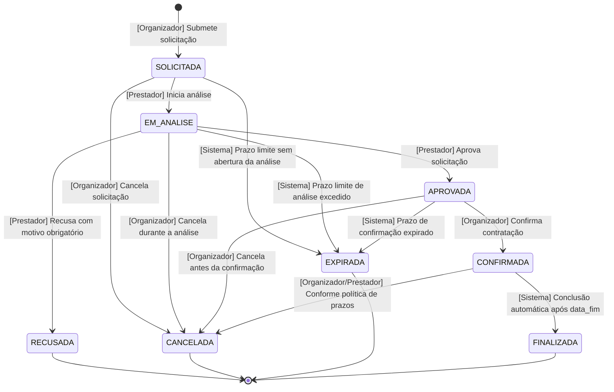
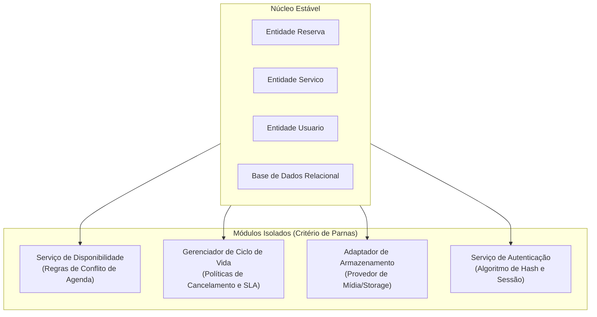
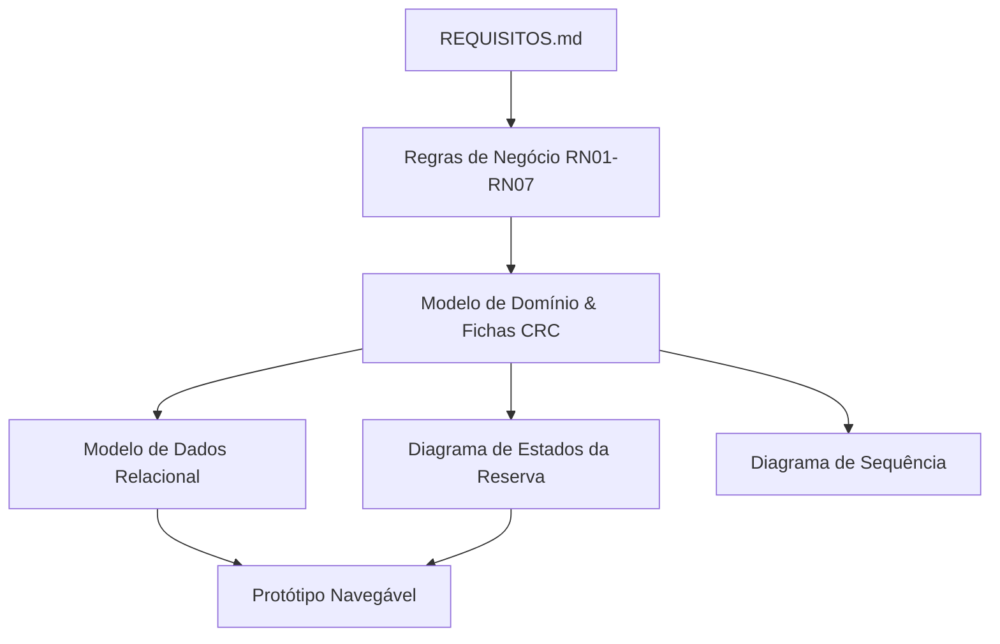

# PROJETO — EventFy

## 📑 Sumário

- [1. Identificação](#1-identificação)
- [2. Problema](#2-problema)
- [3. Objetivo](#3-objetivo)
- [4. Stakeholders e Usuários](#4-stakeholders-e-usuários)
- [5. Escopo](#5-escopo)
- [6. Modelo de Domínio e Análise Léxica](#6-modelo-de-domínio-e-análise-léxica)
  - [6.1 Entidades do Domínio](#61-entidades-do-domínio)
  - [6.2 Tabela de Substantivos para Classes](#62-tabela-de-substantivos-para-classes)
  - [6.3 Decisões de Domínio](#63-decisões-de-domínio)
- [7. Rastreabilidade Unificada](#7-rastreabilidade-unificada)
- [8. Modelo de Dados](#8-modelo-de-dados)
- [9. Decisões de Identidade](#9-decisões-de-identidade)
- [10. Decisões de Apagamento e Exclusão Lógica](#10-decisões-de-apagamento-e-exclusão-lógica)
- [11. Representação de Tempo](#11-representação-de-tempo)
- [12. Armazenamento de Arquivos](#12-armazenamento-de-arquivos)
- [13. Ciclo de Vida da Reserva](#13-ciclo-de-vida-da-reserva)
- [14. Resolução de Lacunas e Decisões Pendentes](#14-resolução-de-lacunas-e-decisões-pendentes)
- [15. Distribuição de Responsabilidades](#15-distribuição-de-responsabilidades)
  - [15.1 Responsabilidades do Sistema — Fichas CRC (Quem Sabe e Quem Faz)](#151-responsabilidades-do-sistema--fichas-crc-quem-sabe-e-quem-faz)
  - [15.2 Divisão de Tarefas da Equipe no Projeto](#152-divisão-de-tarefas-da-equipe-no-projeto)
- [16. Decisões do Projeto e Isolamento de Mudanças](#16-decisões-do-projeto-e-isolamento-de-mudanças)
  - [16.1 Tabela de Decisões do Projeto](#161-tabela-de-decisões-do-projeto)
  - [16.2 Critério de Isolamento de Mudanças de David Parnas (Information Hiding)](#162-critério-de-isolamento-de-mudanças-de-david-parnas-information-hiding)
- [17. Conferência Cruzada](#17-conferência-cruzada)
- [18. Protótipo](#18-protótipo)
- [19. Relação entre os Artefatos](#19-relação-entre-os-artefatos)
- [20. Estrutura da Entrega](#20-estrutura-da-entrega)

---

## 1. Identificação

| Campo | Descrição |
|---|---|
| **Projeto** | EventFy |
| **Disciplina** | Engenharia de Software |
| **Instituição** | Universidade Federal do Tocantins (UFT) — Câmpus Palmas |

O **EventFy** é uma proposta de plataforma web destinada a conectar organizadores de eventos a prestadores de serviços e fornecedores de infraestrutura, centralizando a consulta de serviços, a solicitação de reservas e o acompanhamento das contratações.

O projeto é desenvolvido utilizando práticas de Engenharia de Software, contemplando levantamento e especificação de requisitos, modelagem do domínio, modelagem de dados, prototipação, análise léxica, distribuição de responsabilidades por cartões CRC e isolamento arquitetural por critérios de David Parnas.

---

## 2. Problema

A organização de eventos exige que o responsável procure diferentes prestadores e fornecedores por canais distintos e fragmentados.

Essa dispersão dificulta:

- A localização de serviços adequados
- A consulta das informações e capacidades técnicas dos serviços
- A comparação entre opções disponíveis
- O controle de disponibilidades de agenda
- O acompanhamento em tempo real das solicitações
- O controle unificado das reservas relacionadas a um evento

O EventFy busca centralizar essas atividades em uma única plataforma, permitindo que organizadores encontrem serviços e que prestadores gerenciem com segurança as solicitações recebidas.

---

## 3. Objetivo

### 3.1 Objetivo geral

Desenvolver uma plataforma web que centralize a consulta, solicitação e acompanhamento de serviços destinados à organização de eventos.

### 3.2 Objetivos específicos

- Permitir o cadastro e a autenticação segura dos usuários
- Permitir o cadastro e o gerenciamento de eventos
- Disponibilizar um catálogo estruturado de serviços e estruturas
- Oferecer busca e filtragem por categorias e disponibilidade
- Permitir que organizadores solicitem serviços para seus eventos
- Permitir que prestadores analisem, aprovem ou recusem solicitações com justificativa
- Controlar o ciclo de vida das reservas com máquina de estados rigorosa
- Registrar trilha de auditoria e histórico imutável das reservas
- Permitir a avaliação de serviços após a conclusão da contratação

---

## 4. Stakeholders e Usuários

### 4.1 Organizador

Usuário responsável pela organização de um evento:

- Cadastrar e gerenciar eventos
- Consultar e comparar serviços no catálogo
- Solicitar reservas de serviços
- Confirmar contratações aprovadas
- Cancelar reservas conforme políticas de tolerância
- Acompanhar o histórico de status de suas solicitações
- Avaliar serviços finalizados

### 4.2 Prestador ou fornecedor

Usuário responsável por disponibilizar serviços ou estruturas na plataforma:

- Cadastrar serviços e manter catálogo atualizado
- Estruturar períodos de atendimento e bloqueios de agenda
- Receber notificações de novas solicitações
- Analisar a viabilidade do atendimento
- Aprovar ou recusar solicitações (informando obrigatoriamente a justificativa em recusas)
- Cancelar reservas confirmadas quando houver motivo de força maior
- Acompanhar reservas ativas

### 4.3 Administrador

Perfil responsável pela moderação de catálogo, mediação de disputas operacionais e auditoria de histórico.

---

## 5. Escopo

### 5.1 Funcionalidades previstas

- Cadastro de usuários com credenciais criptografadas
- Autenticação e controle de sessão por perfil
- Gerenciamento completo de eventos
- Cadastro, edição e desativação lógica de serviços
- Gestão estruturada de disponibilidade e bloqueios de agenda
- Consulta, busca e filtragem avançada de serviços
- Solicitação de reservas
- Análise de solicitações pelo prestador
- Aprovação e recusa com justificativa obrigatória
- Confirmação formal da contratação pelo organizador
- Cancelamento motivado em etapas permitidas do ciclo de vida
- Expiração automática de solicitações sem resposta por SLA
- Conclusão automática de serviços pelo sistema
- Auditoria e histórico imutável de transições de reserva
- Avaliação qualitativa e nota após a finalização do serviço

### 5.2 Fora do escopo definido

Processamento de pagamentos bancários/gateways diretos, emissão fiscal automatizada e mensagens de chat em tempo real não fazem parte da entrega desta iteração.

---

## 6. Modelo de Domínio e Análise Léxica

### 6.1 Entidades do Domínio

As entidades que compõem o núcleo conceitual do EventFy são:

| Entidade | Descrição |
|---|---|
| **Usuario** | Representa as pessoas físicas/jurídicas cadastradas e seus papéis na plataforma. |
| **Evento** | Representa o evento promovido pelo organizador para o qual os serviços são demandados. |
| **Servico** | Representa o serviço ou estrutura comercializado pelo prestador. |
| **DisponibilidadeServico** | Representa a estrutura de agenda, períodos livres e bloqueios de atendimento de um serviço (Decisão DP02). |
| **Arquivo** | Metadados e URIs de imagens e documentos anexados aos serviços em catálogo. |
| **Reserva** | Objeto central do domínio, representando o contrato e ciclo de vida da prestação do serviço. |
| **HistoricoReserva** | Registro imutável de auditoria de cada transição de estado da reserva (RF18, RNF05). |
| **Avaliacao** | Registro de nota e comentário realizado pelo organizador pós-finalização da reserva. |

> O modelo de domínio completo está detalhado em [`diagrams/modelo-dominio.md`](./diagrams/modelo-dominio.md).

---

### 6.2 Tabela de Substantivos para Classes

Em conformidade com a técnica de análise léxica (Abbott / OO Analysis — Aula 6), foram extraídos os substantivos presentes nos requisitos e na especificação do problema para identificar as classes de domínio candidatas, descartar conceitos irrelevantes e classificar atributos e papéis:

| Substantivo Identificado | Classificação | Justificativa / Decisão Arquitetural |
|---|---|---|
| **Usuário** | **Classe de Domínio** | Conceito central que encapsula dados de identificação, credenciais e status de acesso. |
| **Organizador** | Papel / Especialização | Não é uma classe separada; representa um papel atribuído a um `Usuario` via `tipo_usuario`. |
| **Prestador / Fornecedor** | Papel / Especialização | Não é uma classe separada; representa um papel atribuído a um `Usuario` via `tipo_usuario`. |
| **Administrador** | Papel / Especialização | Papel administrativo atribuído a um `Usuario` via `tipo_usuario`. |
| **Evento** | **Classe de Domínio** | Entidade fundamental que agrupa as reservas sob responsabilidade de um organizador. |
| **Serviço** | **Classe de Domínio** | Item de catálogo ofertado por um prestador com preço, categoria e mídias. |
| **Disponibilidade / Período / Bloqueio** | **Classe de Domínio** | Promovido a classe (`DisponibilidadeServico`) para modelar intervalos temporais e regras de bloqueio (DP02). |
| **Arquivo / Foto / Mídia** | **Classe de Domínio** | `Arquivo` armazena metadados de anexos armazenados em storage externo. |
| **Reserva** | **Classe de Domínio** | Objeto central do fluxo de negócio que transita pelos estados da máquina de estados. |
| **Histórico / Log de Transição** | **Classe de Domínio** | `HistoricoReserva` garante auditoria temporal e imutabilidade dos estados percorridos. |
| **Avaliação** | **Classe de Domínio** | Registra nota e comentário gerados após a finalização de uma reserva. |
| **Nome, Email, Senha** | Atributos de Classe | Atributos da classe `Usuario`. |
| **Preço, Categoria, Descrição** | Atributos de Classe | Atributos da classe `Servico`. |
| **Data de Início, Data de Fim** | Atributos de Classe | Atributos temporais de `Evento`, `Reserva` e `DisponibilidadeServico`. |
| **Status / Motivo de Recusa** | Atributos de Classe | Atributos da classe `Reserva` e replicados em `HistoricoReserva`. |
| **Nota, Comentário** | Atributos de Classe | Atributos da classe `Avaliacao`. |
| **Pagamento / Gateway** | Fora do Escopo | Não modelado como classe nesta iteração. |

---

### 6.3 Decisões de Domínio

#### 6.3.1 Decisão sobre Herança de Usuário (Usuário vs. Organizador vs. Prestador)
- **Alternativa A (Herança Clássica com Subclasses):** Criar classes especializadas `UsuarioOrganizador` e `UsuarioPrestador` com tabelas separadas.
- **Alternativa B (Composição e Atributo de Papel — ADOTADA):** Manter uma única classe `Usuario` contendo o atributo `tipo_usuario` (ou agregação de papéis).
- **Justificativa da Decisão:** No ecossistema de eventos, é comum que a mesma pessoa física ou empresa atue simultaneamente como organizador de seus eventos e prestador de determinados serviços. A criação de tabelas herdadas rígidas forçaria contas duplicadas, logins redundantes e complexidade desnecessária em chaves estrangeiras. A abordagem por papel unificado atende aos princípios de coesão, simplifica a autenticação e preserva a flexibilidade para evolução futura.

#### 6.3.2 Decisão sobre a Entidade Avaliação
- **Decisão:** A entidade `Avaliacao` é vinculada com cardinalidade estrita `1 : 0..1` à classe `Reserva`, e não diretamente a `Servico` de forma descolada.
- **Justificativa da Decisão:** Uma avaliação somente pode ser submetida quando a respectiva reserva alcançar o estado `FINALIZADA` e pelo organizador titular do contrato. Essa restrição elimina avaliações fraudulentas, avaliações duplicadas ou comentários de usuários que não experimentaram a prestação real do serviço.

---

## 7. Rastreabilidade Unificada

Esta tabela consolida e unifica a matriz de rastreabilidade do projeto (`PROJETO.md` e `modelo-dominio.md`), demonstrando a correspondência direta entre as necessidades especificadas e os elementos do modelo de software:

| Classe / Elemento do Domínio | Requisitos Funcionais | Requisitos Não Funcionais | Regras de Negócio | Diagramas e Modelos Derivados |
|---|---|---|---|---|
| **Usuario** | RF01, RF02, RF03 | RNF01, RNF04 | RN01, RN02 | `modelo-dados.md` (`USUARIO`), Protótipo (login/cadastro), CRC 15.1 |
| **Evento** | RF09, RF15 | RNF04, RNF06 | RN01 | `modelo-dados.md` (`EVENTO`), Protótipo, CRC 15.1 |
| **Servico** | RF04, RF05, RF06, RF07, RF08 | RNF04, RNF06 | RN02, RN06 | `modelo-dados.md` (`SERVICO`), Protótipo (catálogo/detalhe), CRC 15.1 |
| **DisponibilidadeServico** | RF04, RF07, RF10 | RNF02, RNF04 | RN06 | `modelo-dados.md` (`DISPONIBILIDADE_SERVICO`), `sequencia-reserva.md`, Decisão DP02, CRC 15.1 |
| **Arquivo** | RF04, RF07, RF08 | RNF04, RNF06 | RN02 | `modelo-dados.md` (`ARQUIVO`), Decisão D07, CRC 15.1 |
| **Reserva** | RF10, RF11, RF12, RF13, RF14, RF16, RF18 | RNF02, RNF03, RNF04, RNF05, RNF06 | RN03, RN04, RN05, RN06, RN07 | `modelo-dados.md` (`RESERVA`), `estados-reserva.md`, `sequencia-reserva.md`, Protótipo, CRC 15.1 |
| **HistoricoReserva** | RF18 | RNF04, RNF05 | RN07 | `modelo-dados.md` (`HISTORICO_RESERVA`), `estados-reserva.md`, `sequencia-reserva.md`, CRC 15.1 |
| **Avaliacao** | RF17 | RNF04, RNF06 | RN05 | `modelo-dados.md` (`AVALIACAO`), `sequencia-reserva.md`, CRC 15.1 |

A cadeia de rastreabilidade adotada pela equipe garante que:
```
Requisito (RF/RNF) → Regra de Negócio (RN) → Modelo de Domínio → Modelo de Dados → Estados / Sequência → Implementação
```

---

## 8. Modelo de Dados

O modelo de dados relacional reflete fielmente as entidades do domínio e as decisões de modelagem da Aula 6:

As tabelas do modelo de dados são:

- `USUARIO` — Dados de cadastro, credenciais com hash, papel e flag ativo
- `EVENTO` — Registro dos eventos com tipagem `DATETIME` e flag ativo
- `SERVICO` — Dados comerciais e cadastrais dos serviços
- `DISPONIBILIDADE_SERVICO` — Períodos e bloqueios estruturados (substitui o antigo varchar, Decisão DP02)
- `ARQUIVO` — Metadados técnicos e links externos de mídias anexadas
- `RESERVA` — Registro das contratações, status atual e flag ativo
- `HISTORICO_RESERVA` — Tabela relacional de auditoria imutável (RF18, RNF05)
- `AVALIACAO` — Registro de notas e comentários vinculados a reservas concluídas

> O modelo físico/relacional completo com diagramas entidade-relacionamento está documentado em [`diagrams/modelo-dados.md`](./diagrams/modelo-dados.md).

---

## 9. Decisões de Identidade

| Entidade | Identificador | Tipo | Decisão Arquitetural |
|---|---|---|---|
| Usuario | `id_usuario` | Inteiro Autoincremental | Chave primária técnica única (`PK`). `email` possui restrição única (`UK`). |
| Evento | `id_evento` | Inteiro Autoincremental | Chave primária técnica única (`PK`). |
| Servico | `id_servico` | Inteiro Autoincremental | Chave primária técnica única (`PK`). |
| DisponibilidadeServico | `id_disponibilidade` | Inteiro Autoincremental | Chave primária técnica única (`PK`). |
| Arquivo | `id_arquivo` | Inteiro Autoincremental | Chave primária técnica única (`PK`). |
| Reserva | `id_reserva` | Inteiro Autoincremental | Chave primária técnica única (`PK`). |
| HistoricoReserva | `id_historico` | Inteiro Autoincremental | Chave primária técnica única (`PK`), estritamente sequencial e imutável. |
| Avaliacao | `id_avaliacao` | Inteiro Autoincremental | Chave primária técnica única (`PK`). |

---

## 10. Decisões de Apagamento e Exclusão Lógica

Para garantir a integridade referencial e o cumprimento dos requisitos de auditoria e conformidade (RNF05, RNF06), nenhuma entidade com histórico sofre exclusão física (`DELETE` no banco de dados). Em substituição, adota-se o padrão corporativo de **Exclusão Lógica (Soft Delete)** através da coluna `ativo` (`boolean`):

### 10.1 Usuários
Usuários com histórico de contratações, serviços ofertados ou eventos cadastrados têm a coluna `ativo` ajustada para `false`. Isso impede novos acessos e operações sem corromper contratos passados.

### 10.2 Serviços
Serviços desativados pelo prestador têm `ativo = false`. O serviço é removido do catálogo e bloqueado para novas reservas, preservando o histórico das contratações já firmadas.

### 10.3 Reservas
Reservas canceladas, recusadas ou finalizadas permanecem intactas no banco (`ativo = false` ou status terminal). O rastreamento de suas transições é preservado para sempre em `HISTORICO_RESERVA`.

### 10.4 Eventos
Eventos cancelados ou arquivados recebem `ativo = false`. As reservas vinculadas são tratadas automaticamente pelas regras da máquina de estados.

### 10.5 Disponibilidade e Bloqueios
Períodos de disponibilidade removidos ou invalidados recebem `ativo = false`, garantindo rastreabilidade histórica sobre a agenda pregressa do prestador.

### 10.6 Arquivos
Mídias desvinculadas recebem `ativo = false`, viabilizando rotinas agendadas assíncronas para limpeza física no storage externo caso não haja mais referência ativa.

---

## 11. Representação de Tempo

Todos os registros temporais utilizam tipos tipados no SGBD, eliminando representações como texto livre ou formatações ambíguas:

- `DATETIME` uniforme para `Evento.data_inicio` e `Evento.data_fim`, permitindo agendamento com precisão de horas e minutos (ex.: evento das 18h às 23h), garantindo alinhamento com a granularidade de reservas.
- `DATETIME` para `Reserva.data_inicio` e `Reserva.data_fim`.
- `DATETIME` para `DisponibilidadeServico.data_inicio` e `DisponibilidadeServico.data_fim`.
- `DATETIME` para timestamps de auditoria: `criado_em`, `atualizado_em` e `HistoricoReserva.data_hora`.

---

## 12. Armazenamento de Arquivos

Conforme decisão **D07**, o sistema desacopla o armazenamento binário de arquivos da base de dados relacional:

- **Storage Externo:** Objetos binários (imagens de serviços, PDFs) são gravados em storage de objetos ou sistema de arquivos com URL estática gerada.
- **Metadados Relacionais:** A tabela `ARQUIVO` mantém apenas os metadados (`nome_original`, `url`, `tipo_mime`, `tamanho`, `ativo`, `criado_em`), evitando inchaço e degradação de performance no banco de dados.

---

## 13. Ciclo de Vida da Reserva

A **Reserva** é o objeto central do fluxo de valor do EventFy. Todos os estados são **alcançáveis** e possuem rotas de **saída** definidas, sem deadlocks.



### Síntese das Transições e Atores
1. **Criação:** O Organizador cria a solicitação (`SOLICITADA`).
2. **Análise:** O Prestador abre a solicitação (`EM_ANALISE`).
3. **Aprovação / Recusa:** O Prestador pode aprovar (`APROVADA`) ou recusar informando motivo (`RECUSADA`).
4. **Confirmação:** O Organizador confirma a proposta aprovada (`CONFIRMADA`).
5. **Cancelamento:** O Organizador pode cancelar em `SOLICITADA`, `EM_ANALISE` ou `APROVADA`. Ambas as partes podem cancelar em `CONFIRMADA` respeitando as políticas de prazo.
6. **Expiração:** O **Sistema** altera compulsoriamente para `EXPIRADA` quando prazos limites de atendimento ou confirmação forem ultrapassados.
7. **Finalização:** O **Sistema** altera automaticamente para `FINALIZADA` assim que a `data_fim` do contrato for atingida, liberando a avaliação.

> O detalhamento completo com matriz de transições e garantias está documentado em [`diagrams/estados-reserva.md`](./diagrams/estados-reserva.md).

---

## 14. Resolução de Lacunas e Decisões Pendentes

Durante as atividades de modelagem e consistência da Aula 6, foram solucionadas as lacunas identificadas nas iterações anteriores:

- **Disponibilidade Estruturada (DP02 — RESOLVIDO):** O antigo atributo `varchar disponibilidade` foi substituído pela entidade relacional `DisponibilidadeServico`, permitindo registrar múltiplos intervalos de atendimento e bloqueios com suporte a consultas de sobreposição.
- **Histórico e Auditoria da Reserva (DP06 — RESOLVIDO):** Implementada a tabela relacional imutável `HISTORICO_RESERVA`, garantindo conformidade com RF18 e RNF05.
- **Cancelamento Ampliado e Expiração (DP03 — RESOLVIDO):** Alinhadas as regras permitindo cancelamento do organizador antes da análise e durante a aprovação, além da criação do estado `EXPIRADA` para timeouts automáticos.
- **Executor da Finalização (RESOLVIDO):** Definido que a transição de `CONFIRMADA` para `FINALIZADA` é de responsabilidade de rotina agendada do **Sistema** ao detectar a passagem da `data_fim`.

---

## 15. Distribuição de Responsabilidades

### 15.1 Responsabilidades do Sistema — Fichas CRC (Quem Sabe e Quem Faz)

Em conformidade com a técnica de **Cartões CRC (Class-Responsibility-Collaborator — Aula 6)**, as responsabilidades de software foram distribuídas identificando claramente o que cada classe do sistema **sabe** (conhecimento/dados mantidos) e o que cada classe **faz** (comportamentos/operações executadas), juntamente com suas classes colaboradoras:

#### Ficha CRC 1: `Usuario`
| Responsabilidade: O que a classe sabe ("Quem Sabe") | Responsabilidade: O que a classe faz ("Quem Faz") | Colaboradores |
|---|---|---|
| • Sabe seus dados de identificação (id, nome).<br>• Sabe suas credenciais de acesso (email, senha com hash).<br>• Sabe seus papéis e permissões no sistema (tipo_usuario).<br>• Sabe seu estado de ativação (ativo). | • Valida formato e unicidade do e-mail.<br>• Realiza autenticação conferindo hash da senha.<br>• Altera informações cadastrais permitidas.<br>• Executa desativação lógica da conta. | `Evento`, `Servico`, `Reserva`, `HistoricoReserva` |

#### Ficha CRC 2: `Evento`
| Responsabilidade: O que a classe sabe ("Quem Sabe") | Responsabilidade: O que a classe faz ("Quem Faz") | Colaboradores |
|---|---|---|
| • Sabe seu identificador único, nome e descrição.<br>• Sabe as datas e horários de início e término (`dataInicio`, `dataFim`).<br>• Sabe seu local de realização.<br>• Sabe quem é seu organizador responsável.<br>• Sabe seu status de ativação. | • Valida coerência do intervalo de datas (`dataInicio <= dataFim`).<br>• Permite associar novas reservas de serviços.<br>• Notifica reservas vinculadas em caso de cancelamento do evento. | `Usuario`, `Reserva` |

#### Ficha CRC 3: `Servico`
| Responsabilidade: O que a classe sabe ("Quem Sabe") | Responsabilidade: O que a classe faz ("Quem Faz") | Colaboradores |
|---|---|---|
| • Sabe seus dados descritivos (id, nome, categoria, descrição).<br>• Sabe seu preço base cobrado.<br>• Sabe quem é o prestador titular responsável.<br>• Sabe seus arquivos de mídia anexados.<br>• Sabe seu estado no catálogo (`ativo`). | • Atualiza dados comerciais.<br>• Desativa oferta no catálogo preservando histórico.<br>• Delega consulta de agenda para `DisponibilidadeServico`. | `Usuario`, `DisponibilidadeServico`, `Arquivo`, `Reserva` |

#### Ficha CRC 4: `DisponibilidadeServico`
| Responsabilidade: O que a classe sabe ("Quem Sabe") | Responsabilidade: O que a classe faz ("Quem Faz") | Colaboradores |
|---|---|---|
| • Sabe a qual serviço pertence.<br>• Sabe os períodos de atendimento e bloqueio (`dataInicio`, `dataFim`).<br>• Sabe o tipo do registro (`DISPONIVEL`, `BLOQUEIO_MANUAL`, `RESERVA`).<br>• Sabe o motivo do bloqueio e se está ativo. | • Verifica se um intervalo solicitado colide com bloqueios vigentes.<br>• Cria bloqueios manuais ou automáticos.<br>• Libera bloqueios quando reservas são canceladas ou recusadas. | `Servico`, `Reserva` |

#### Ficha CRC 5: `Reserva`
| Responsabilidade: O que a classe sabe ("Quem Sabe") | Responsabilidade: O que a classe faz ("Quem Faz") | Colaboradores |
|---|---|---|
| • Sabe seu identificador único e código de contrato.<br>• Sabe o período solicitado (`dataInicio`, `dataFim`).<br>• Sabe o evento, serviço e usuários envolvidos.<br>• Sabe seu estado atual na máquina de estados.<br>• Sabe justificativa de recusa ou cancelamento. | • Valida consistência do período em relação ao evento.<br>• Coordena transições de estado conforme regras de RN05.<br>• Exige motivo obrigatório para recusas.<br>• Dispara registro de auditoria em `HistoricoReserva`. | `Evento`, `Servico`, `Usuario`, `HistoricoReserva`, `DisponibilidadeServico`, `Avaliacao` |

#### Ficha CRC 6: `HistoricoReserva`
| Responsabilidade: O que a classe sabe ("Quem Sabe") | Responsabilidade: O que a classe faz ("Quem Faz") | Colaboradores |
|---|---|---|
| • Sabe a reserva auditada.<br>• Sabe o estado anterior e o estado resultante.<br>• Sabe a data e hora precisa da alteração.<br>• Sabe o autor da operação (usuário ou sistema).<br>• Sabe o motivo ou observação registrada. | • Registra imutavelmente a transição realizada.<br>• Fornece trilha temporal de auditoria para consulta e relatórios. | `Reserva`, `Usuario` |

#### Ficha CRC 7: `Avaliacao`
| Responsabilidade: O que a classe sabe ("Quem Sabe") | Responsabilidade: O que a classe faz ("Quem Faz") | Colaboradores |
|---|---|---|
| • Sabe a qual reserva finalizada está vinculada.<br>• Sabe a nota numérica (1 a 5) atribuída.<br>• Sabe o comentário textual e a data de criação.<br>• Sabe quem foi o organizador avaliador. | • Valida faixa de nota válida (1 a 5).<br>• Garante unicidade de avaliação por reserva.<br>• Disponibiliza dados para cômputo da reputação do serviço. | `Reserva`, `Servico`, `Usuario` |

#### Ficha CRC 8: `Arquivo`
| Responsabilidade: O que a classe sabe ("Quem Sabe") | Responsabilidade: O que a classe faz ("Quem Faz") | Colaboradores |
|---|---|---|
| • Sabe seu nome original, URL de acesso externo, tipo MIME e tamanho em bytes.<br>• Sabe a qual serviço está vinculado.<br>• Sabe seu status de ativação. | • Valida formatos e tipos MIME permitidos.<br>• Mantém integridade da referência para o storage externo. | `Servico` |

---

### 15.2 Divisão de Tarefas da Equipe no Projeto

A divisão de responsabilidades operacionais da equipe de desenvolvimento do EventFy está estruturada da seguinte forma:

| Responsabilidade no Projeto | Integrante Principal | Equipe de Apoio |
|---|---|---|
| Levantamento, Revisão e Rastreabilidade de Requisitos | Eduarda Negreiro | Todos |
| Modelagem de Domínio, Consistência e Cartões CRC | Igor Anicezio Oliveira (Pessoa 4) | Equipe de Modelagem |
| Modelagem de Dados, Tipagem e Estrutura Relacional | Pessoa 2 / Responsável por Dados | Igor Anicezio Oliveira |
| Diagramas de Estados, Transições e Sequência | Igor Anicezio Oliveira (Pessoa 4) | Equipe de Modelagem |
| Prototipação Navegável e Telas de Fluxo | Pessoa 5 / Responsável por Interface | Todos |
| Processos de Negócio e Reconciliação | Thalita Teixeira Menezes / Igor Anicezio | Todos |
| Conferência Cruzada e Revisão de PRs | Revisor designado (Pessoa 3) | Autor do PR |

---

## 16. Decisões do Projeto e Isolamento de Mudanças

### 16.1 Tabela de Decisões do Projeto

| ID | Decisão Arquitetural | Motivo | Consequência |
|---|---|---|---|
| **D01** | Identificadores inteiros próprios (`PK`) | Evitar ambiguidades de chaves naturais | Identidade técnica estável e eficiente |
| **D02** | E-mail único para usuários (`UK`) | Evitar duplicação de credenciais | Integridade de login garantida |
| **D03** | Exclusão lógica via atributo `ativo` | Preservar rastreabilidade histórica e conformidade legal | Registros não são purgados fisicamente |
| **D04** | Ciclo de vida gerido por máquina de estados | Rigor no fluxo de contratação | Transições ilegais são bloqueadas pelo sistema |
| **D05** | Motivo obrigatório em recusas e cancelamentos | Transparência e justificativa na relação comercial | `motivo_recusa` é campo mandatório |
| **D06** | Tipos temporais estruturados (`DATETIME`) | Evitar inconsistências de texto livre e viabilizar consultas temporais | Granularidade horária para eventos e reservas |
| **D07** | Armazenamento externo de arquivos com metadados em BD | Evitar inchaço no SGBD e otimizar tempo de backup | Banco armazena URL e metadados técnicos |
| **D08** | Preservação de histórico imutável (`HISTORICO_RESERVA`) | Auditoria completa de todas as alterações (RF18, RNF05) | Cada mudança de estado gera nova linha no histórico |
| **D09** | Estruturação de disponibilidade em tabela própria (DP02) | Superar a limitação de varchar e suportar múltiplos intervalos e bloqueios | Entidade `DISPONIBILIDADE_SERVICO` criada |
| **D10** | Unificação de usuário com papéis em vez de herança | Permitir que o mesmo usuário seja organizador e prestador | Simplificação do modelo relacional e autenticação única |
| **D11** | Conclusão automática de serviços por rotina do sistema | Evitar que reservas fiquem pendentes indefinidamente após o evento | Transição para `FINALIZADA` executada automaticamente |

---

### 16.2 Critério de Isolamento de Mudanças de David Parnas (Information Hiding)

O princípio de modularidade formulado por **David L. Parnas (1972)** estabelece que a decomposição de um sistema de software em módulos deve ter como critério fundamental o **ocultamento de decisões de projeto que têm maior probabilidade de sofrer alterações futuras** (*information hiding*).

No EventFy, foram analisadas as regras de negócio mais voláteis e definidas suas estratégias de isolamento arquitetural:



#### 1. Regras de Cálculo e Conflito de Disponibilidade de Agenda
- **Probabilidade de Mudança:** **ALTA**. Políticas de tolerância de agenda costumam variar com frequência (ex.: intervalo de segurança entre eventos, reservas parciais por turno, bloqueio em feriados, regras para múltiplos prestadores na mesma estrutura).
- **Onde Fica Isolado:** Encapsulado no módulo de domínio `ServicoDisponibilidade` (`CalculadoraDisponibilidade`).
- **Benefício de Ocultamento:** A entidade `Servico` e a camada de apresentação (`UI`) desconhecem os algoritmos de checagem temporal. Se a regra de sobreposição for alterada de "intervalo fechado" para "janela com buffer de 2 horas para limpeza/deslocamento", somente o `ServicoDisponibilidade` é modificado, mantendo o restante do software intacto.

#### 2. Políticas de Cancelamento, Multas e Janelas de Expiração (SLA)
- **Probabilidade de Mudança:** **ALTA**. Prazos para cancelamento gratuito (ex.: até 7 dias antes vs. até 24 horas antes) e tolerâncias de expiração sem resposta (24h, 48h ou 72h) dependem de ajustes comerciais e regulatórios.
- **Onde Fica Isolado:** Encapsulado no módulo `PoliticaCancelamento` e no `GerenciadorCicloVidaReserva`.
- **Benefício de Ocultamento:** A entidade `Reserva` apenas invoca `PoliticaCancelamento.permitirCancelamento(reserva, ator, dataAtual)`. A introdução de cobrança de taxas de cancelamento ou prazos diferenciados por categoria de serviço não altera a estrutura de dados nem as APIs existentes.

#### 3. Mecanismo de Armazenamento de Arquivos e Mídia
- **Probabilidade de Mudança:** **MÉDIA-ALTA**. O sistema pode iniciar gravando arquivos em disco local no ambiente de desenvolvimento acadêmico e migrar para AWS S3, Cloudflare R2 ou Google Cloud Storage em ambiente produtivo.
- **Onde Fica Isolado:** Encapsulado por trás da interface `ServicoArmazenamento` (`StorageProvider`), aplicando o padrão de Adaptador (*Adapter*).
- **Benefício de Ocultamento:** O modelo de dados `ARQUIVO` e a lógica de cadastro de serviço lidam apenas com streams de bytes e URIs abstratas. A troca de provedor de nuvem resume-se à injeção de uma nova implementação do adaptador, sem impacto sobre a lógica de negócio.

#### 4. Mecanismo de Autenticação e Criptografia de Credenciais
- **Probabilidade de Mudança:** **MÉDIA**. A evolução dos padrões criptográficos (ex.: migração de bcrypt para Argon2id) ou a adoção futura de autenticação federada (OAuth2, OpenID Connect com Google) exigem isolamento.
- **Onde Fica Isolado:** Encapsulado no módulo `ServicoAutenticacao` (`TokenProvider` / `PasswordHasher`).
- **Benefício de Ocultamento:** A entidade `Usuario` armazena somente `senha_hash`. Mudanças de algoritmos e políticas de expiração de token são transparentes para os controladores e demais entidades.

---

## 17. Conferência Cruzada

A conferência cruzada registra as verificações formais efetuadas entre os artefatos por integrantes distintos dos respectivos autores:

| Artefato | Autor | Revisor | Itens Verificados | Resultado |
|---|---|---|---|---|
| `REQUISITOS.md` | Equipe | Pessoa 3 | Numeração unificada RF/RNF/RN, critérios de aceitação e rastreabilidade | 🟢 Concluído |
| Modelo de domínio | Pessoa 4 | Pessoa 3 | Entidades completas, `DisponibilidadeServico`, `HistoricoReserva`, rastreabilidade | 🟢 Concluído |
| Modelo de dados | Pessoa 4 | Pessoa 3 | Chaves primárias/estrangeiras, tipos `DATETIME`, coluna `ativo`, tabelas adicionadas | 🟢 Concluído |
| Estados da reserva | Pessoa 4 | Pessoa 3 | Alcançabilidade, cancelamentos em todas as etapas, expiração e executor do finalizado | 🟢 Concluído |
| Diagrama de sequência | Pessoa 4 | Pessoa 3 | Fluxo principal, 4 fluxos alternativos, consistência com dados e regras | 🟢 Concluído |
| Protótipo | Equipe | Pessoa 4 | Aderência aos estados e tela de recusa com motivo | 🟢 Concluído |

---

## 18. Protótipo

O protótipo navegável cobre o fluxo de reserva, recusa com motivo e aprovação:

**Fluxo principal:**
```
Início → Catálogo → Detalhes do serviço → Solicitação → Em análise → Aceitar ou Recusar
```

**Fluxo de recusa:**
```
Recusar → Motivo da recusa obrigatório → Solicitação recusada → Voltar ao catálogo
```

**Fluxo de aprovação e confirmação:**
```
Aceitar → Reserva aprovada → Confirmar → Reserva confirmada
```

O protótipo está disponível em [`prototipo/`](./prototipo).

---

## 19. Relação entre os Artefatos



Todos os artefatos contam a mesma história:
- Os mesmos nomes de entidades e atributos são utilizados em domínio, dados e requisitos.
- A máquina de estados de `estados-reserva.md` governa as transições em `sequencia-reserva.md` e em `REQUISITOS.md` (RN05).
- A auditoria por `HISTORICO_RESERVA` garante conformidade com RF18 e RNF05 em todos os modelos.

---

## 20. Estrutura da Entrega

```
/
├── README.md
├── CONTRIBUTING.md
├── docs/
│   ├── PROJETO.md
│   ├── REQUISITOS.md
│   ├── PROCESSOS-NEGOCIO.md
│   ├── CONFERENCIA_CRUZADA.md
│   ├── README_ENTREGA.md
│   └── diagrams/
│       ├── modelo-dominio.md
│       ├── modelo-dados.md
│       ├── estados-reserva.md
│       └── sequencia-reserva.md
└── prototipo/
    ├── index.html
    ├── catalogo.html
    ├── servico.html
    ├── reserva.html
    ├── recusada.html
    ├── aprovada.html
    ├── confirmada.html
    ├── css/
    │   └── style.css
    └── js/
        └── script.js
```

