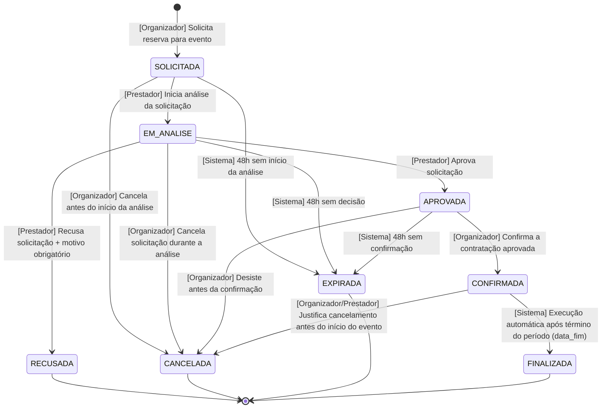

# Diagrama de estados — Reserva

A `Reserva` é o objeto central do sistema EventFy, representando o fluxo principal de negociação e contratação entre organizador e prestador de serviços.

## Diagrama de Estados (UML State Machine)

## Tabela de Estados e Critérios de Consistência

Todos os estados do ciclo de vida são **alcançáveis** e possuem rotas explícitas de **saída** para estados subsequentes ou nós finais (`[*]`), garantindo ausência de bloqueios (*deadlocks*) e caminhos órfãos:

| Estado | Tipo | Descrição | Condição de Entrada | Saídas Válidas |
|---|---|---|---|---|
| `SOLICITADA` | Inicial | Solicitação enviada pelo organizador e aguardando triagem. | Organizador submete formulário com dados válidos e sem conflito prévio de agenda. | `EM_ANALISE`, `CANCELADA`, `EXPIRADA` |
| `EM_ANALISE` | Transitório | Prestador tomou conhecimento e está avaliando detalhes operacionais. | Prestador abre a solicitação no painel. | `APROVADA`, `RECUSADA`, `CANCELADA`, `EXPIRADA` |
| `APROVADA` | Transitório | Prestador declarou ter capacidade e concordância em atender ao pedido. | Prestador clica em aprovar (reserva pré-alocada na agenda). | `CONFIRMADA`, `CANCELADA`, `EXPIRADA` |
| `CONFIRMADA` | Transitório / Ativo | Contrato formalizado com agenda bloqueada em definitivo. | Organizador confirma a proposta aprovada. | `FINALIZADA`, `CANCELADA` |
| `RECUSADA` | Terminal | Prestador declinou a solicitação. | Prestador recusa informando justificativa obrigatória (RN04). | `[*]` |
| `CANCELADA` | Terminal | Reserva cancelada com justificativa pelo organizador ou prestador autorizado. | O organizador cancela nos estados permitidos; o prestador cancela em `CONFIRMADA`, sempre antes do início do evento (RF14, RN09). | `[*]` |
| `EXPIRADA` | Terminal | Reserva finalizada compulsoriamente por decurso de prazo sem resposta. | Rotina agendada do sistema identifica estouro de SLA/tempo limite (RN05). | `[*]` |
| `FINALIZADA` | Terminal | Serviço prestado e período decorrido com sucesso. Habilita avaliação. | Sistema executa transição automática após `data_fim` do evento/serviço. | `[*]` |

## Transições e Atores Executores

| Transição | De | Para | Ator / Executor | Gatilho / Regra de Negócio |
|---|---|---|---|---|
| **T01** | `[*]` | `SOLICITADA` | Organizador | Submissão de reserva para serviço ativo (RF10, RN03). |
| **T02** | `SOLICITADA` | `EM_ANALISE` | Prestador | Prestador acessa a solicitação no sistema (RF11). |
| **T03** | `SOLICITADA` | `CANCELADA` | Organizador | Antes do início do evento e com justificativa obrigatória registrada em `HISTORICO_RESERVA` (RF14, RN09). |
| **T04** | `SOLICITADA` | `EXPIRADA` | **Sistema** | Prestador não inicia a análise dentro de 48 horas da solicitação (RN05). |
| **T05** | `EM_ANALISE` | `APROVADA` | Prestador | Prestador aceita atender ao evento no período (RF12). |
| **T06** | `EM_ANALISE` | `RECUSADA` | Prestador | Prestador rejeita e preenche `motivo_recusa` obrigatório (RF12, RN04). |
| **T07** | `EM_ANALISE` | `CANCELADA` | Organizador | Antes do início do evento e com justificativa obrigatória registrada em `HISTORICO_RESERVA` (RF14, RN09). |
| **T08** | `EM_ANALISE` | `EXPIRADA` | **Sistema** | Prestador não decide dentro de 48 horas do início da análise (RN05). |
| **T09** | `APROVADA` | `CONFIRMADA` | Organizador | Organizador valida a aceitação e confirma a reserva (RF13). Bloqueia a agenda. |
| **T10** | `APROVADA` | `CANCELADA` | Organizador | Antes da confirmação e do início do evento, com justificativa obrigatória registrada em `HISTORICO_RESERVA` (RF14, RN09). |
| **T11** | `APROVADA` | `EXPIRADA` | **Sistema** | Organizador não confirma dentro de 48 horas da aprovação (RN05). |
| **T12** | `CONFIRMADA` | `FINALIZADA` | **Sistema** *(Rotina Automática)* | Após atingir e transcorrer a `data_fim` da reserva, o sistema altera o status para `FINALIZADA` e libera o fluxo de avaliação (RF16, RF17). |
| **T13** | `CONFIRMADA` | `CANCELADA` | Organizador / Prestador | Antes do início do evento e com justificativa obrigatória registrada em `HISTORICO_RESERVA` (RF14, RN09). |

## Garantias de Consistência e Auditoria

1. **Rastreabilidade (RF18, RNF05):** Cada transição de T01 a T13 gera obrigatoriamente um registro na tabela `HISTORICO_RESERVA`, contendo estado anterior, estado novo, data/hora exata, usuário executor (ou identificação do sistema nas transições T04, T08, T11 e T12) e justificativa.
2. **Imutabilidade e Exclusão Lógica:** Nenhuma reserva em qualquer estado é excluída fisicamente do banco de dados (Seção 10 do PROJETO.md).
3. **Desbloqueio de Agenda:** Caso uma reserva passe para `RECUSADA`, `CANCELADA` ou `EXPIRADA`, qualquer alocação provisória ou bloqueio em `DISPONIBILIDADE_SERVICO` é imediatamente liberado (RN06).
