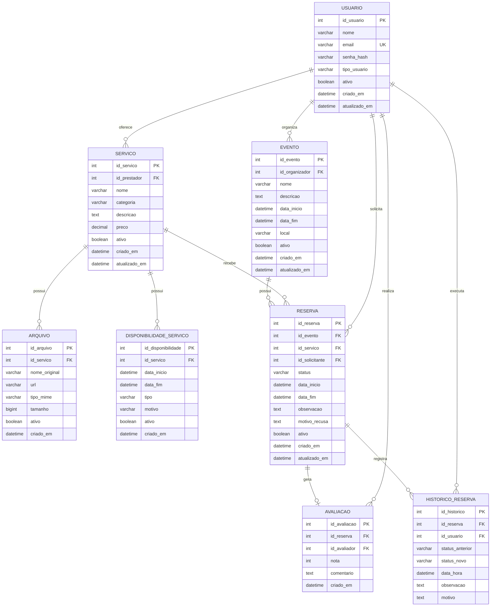

# Modelo de dados — EventFy

## Observações de Modelagem e Consistência

- **Identidade técnica:** Todas as entidades possuem chaves primárias inteiras autoincrementais (`PK`), assegurando identidade única (RNF04).
- **Unicidade de credencial:** `USUARIO.email` possui restrição de unicidade (`UK`) para evitar contas duplicadas (RF01, D02).
- **Histórico e auditoria da reserva (RF18, RNF05):** A tabela `HISTORICO_RESERVA` armazena de forma imutável cada mudança de estado da reserva, preservando o estado anterior, novo estado, data/hora, observação/motivo e o usuário responsável (ou nulo quando a transição for disparada pelo sistema).
- **Estruturação de disponibilidade (Decisão DP02):** A coluna textual `disponibilidade` de `SERVICO` foi substituída pela tabela relacional `DISPONIBILIDADE_SERVICO`. Esta modelagem permite registrar múltiplos períodos de atendimento, bloqueios manuais pelo prestador e reservas confirmadas, viabilizando consultas eficientes por sobreposição de intervalos temporais e prevenindo conflitos (RN06, RNF02).
- **Exclusão lógica e consistência histórica (Seção 10 do PROJETO.md):** As tabelas `USUARIO`, `EVENTO`, `SERVICO`, `RESERVA`, `DISPONIBILIDADE_SERVICO` e `ARQUIVO` contam com a coluna `ativo` (`boolean`), garantindo que registros vinculados a contratações e históricos não sejam fisicamente excluídos, preservando a integridade referencial.
- **Tipagem temporal do Evento e Reserva (Seção 11 do PROJETO.md):** As colunas `data_inicio` e `data_fim` de `EVENTO` utilizam `datetime` (alinhando-se com `RESERVA` e permitindo granularidade de data e horário para reservas precisas de serviços).
- **Ciclo de vida e estados da reserva:** A coluna `RESERVA.status` reflete a máquina de estados oficial (`SOLICITADA`, `EM_ANALISE`, `APROVADA`, `CONFIRMADA`, `FINALIZADA`, `RECUSADA`, `CANCELADA`, `EXPIRADA`).
- **Motivo de recusa e cancelamento:** `RESERVA.motivo_recusa` é obrigatório quando o estado for `RECUSADA` (RN04) e é replicado no registro correspondente em `HISTORICO_RESERVA`.
- **Armazenamento de mídia (D07):** A tabela `ARQUIVO` armazena apenas metadados técnicos e a `url` do arquivo armazenado em storage externo seguro.
