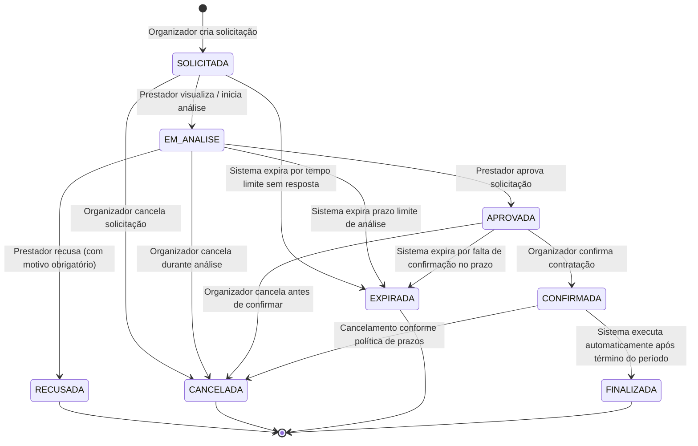
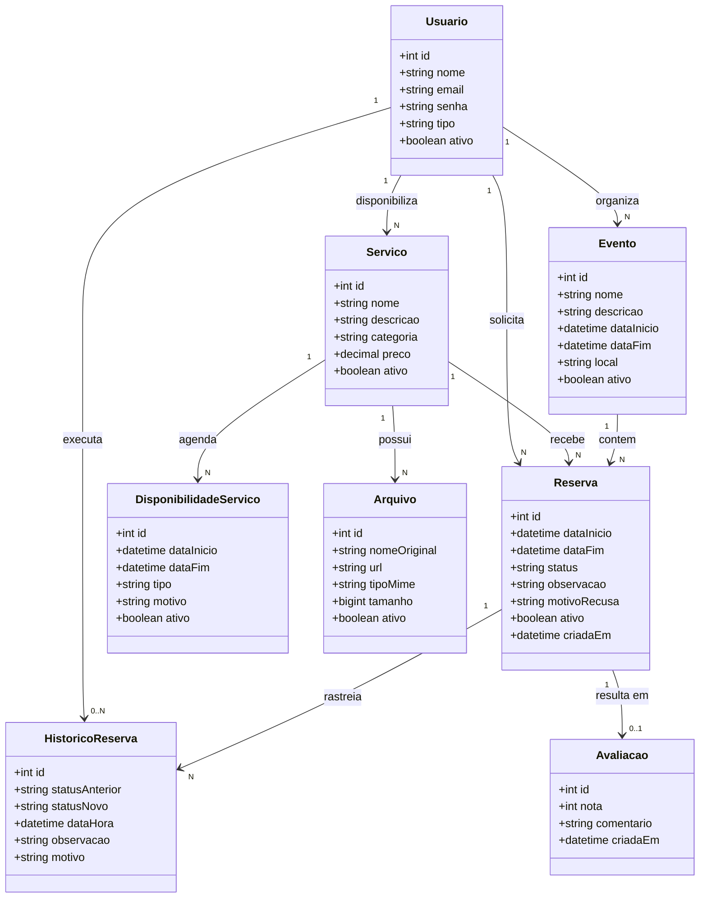
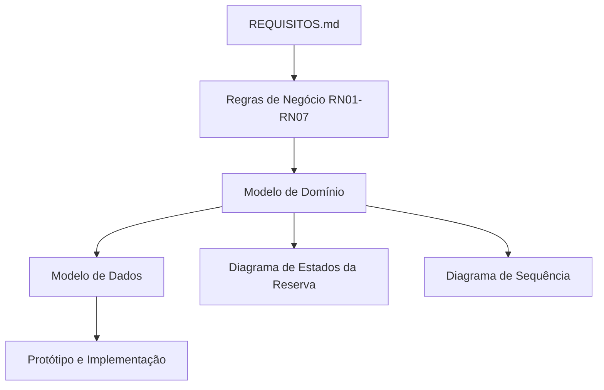

# Modelo de Domínio — EventFy

## Sumário

- [1. Visão geral](#1-visão-geral)
- [2. Entidades](#2-entidades)
- [3. Relacionamentos](#3-relacionamentos)
- [4. Estados da Reserva](#4-estados-da-reserva)
- [5. Transições válidas](#5-transições-válidas)
- [6. Diagrama conceitual](#6-diagrama-conceitual)
- [7. Rastreabilidade](#7-rastreabilidade)
- [8. Decisões e pontos resolvidos/pendentes](#8-decisões-e-pontos-resolvidospendentes)
- [9. Consistência com os requisitos](#9-consistência-com-os-requisitos)

---

## 1. Visão geral

O modelo de domínio representa os principais conceitos do EventFy, seus atributos, responsabilidades e relacionamentos.

O modelo foi construído a partir dos requisitos funcionais, requisitos não funcionais e regras de negócio definidos em `REQUISITOS.md`.

As principais entidades do domínio são:

- `Usuario`
- `Evento`
- `Servico`
- `DisponibilidadeServico`
- `Arquivo`
- `Reserva`
- `HistoricoReserva`
- `Avaliacao`

---

## 2. Entidades

### 2.1 Usuario

Representa uma pessoa cadastrada na plataforma.

Um usuário pode atuar como organizador de eventos ou como prestador/fornecedor de serviços, de acordo com seu tipo de usuário.

#### Atributos

| Atributo | Descrição |
|---|---|
| id | Identificador único do usuário |
| nome | Nome do usuário |
| email | Endereço de e-mail utilizado no cadastro e autenticação |
| senha | Credencial do usuário, armazenada de forma protegida |
| tipo | Tipo de usuário (Organizador, Prestador ou Administrador) |
| ativo | Indica se o usuário está ativo (exclusão lógica) |

#### Regras

- O email deve ser único.
- O usuário deve possuir um identificador único.
- O usuário deve possuir um tipo definido.
- Usuários desativados não devem realizar operações que exijam uma conta ativa.
- A senha não deve ser armazenada em texto puro.

#### Requisitos relacionados

`RF01` · `RF02` · `RF03` · `RNF01` · `RNF04`

---

### 2.2 Evento

Representa um evento criado por um organizador.

Um evento pertence a um único organizador.

#### Atributos

| Atributo | Descrição |
|---|---|
| id | Identificador único do evento |
| nome | Nome do evento |
| descricao | Descrição do evento |
| dataInicio | Data e hora de início (DATETIME) |
| dataFim | Data e hora de término (DATETIME) |
| local | Local de realização do evento |
| ativo | Indica se o evento está ativo (exclusão lógica) |

#### Regras

- Um evento deve possuir um único organizador responsável.
- A data de início não pode ser posterior à data de término.
- O organizador somente pode gerenciar eventos sob sua responsabilidade.
- Alterações ou cancelamento de eventos com reservas devem disparar o tratamento das reservas associadas.
- Eventos com histórico de reservas não são excluídos fisicamente, apenas desativados logicamente (`ativo = false`).

#### Requisitos relacionados

`RF09` · `RF15` · `RN01` · `RNF06`

---

### 2.3 Servico

Representa um serviço ou estrutura disponibilizado por um prestador ou fornecedor.

#### Atributos

| Atributo | Descrição |
|---|---|
| id | Identificador único do serviço |
| nome | Nome do serviço |
| descricao | Descrição do serviço |
| categoria | Categoria do serviço |
| preco | Valor cobrado pelo serviço |
| ativo | Indica se o serviço está disponível para novas solicitações (exclusão lógica) |

#### Regras

- Um serviço deve possuir um prestador ou fornecedor responsável.
- Um serviço desativado não pode receber novas solicitações.
- A desativação de um serviço não deve eliminar seu histórico nem reservas passadas.
- O preço deve possuir valor válido não negativo.
- A disponibilidade do serviço é gerenciada por períodos e bloqueios estruturados (`DisponibilidadeServico`).

#### Requisitos relacionados

`RF04` · `RF05` · `RF06` · `RF07` · `RF08` · `RN02` · `RN06`

---

### 2.4 DisponibilidadeServico

Representa a estrutura de agenda do serviço, modelando períodos de atendimento, bloqueios operacionais ou indisponibilidades temporárias (Decisão DP02).

#### Atributos

| Atributo | Descrição |
|---|---|
| id | Identificador único do período de disponibilidade/bloqueio |
| dataInicio | Início do intervalo de tempo (DATETIME) |
| dataFim | Fim do intervalo de tempo (DATETIME) |
| tipo | Tipo do período (`DISPONIVEL`, `BLOQUEIO_MANUAL`, `RESERVA`) |
| motivo | Justificativa do bloqueio ou descrição do período |
| ativo | Indica se o registro de disponibilidade está vigente |

#### Regras

- Um período de disponibilidade/bloqueio pertence a um único serviço.
- `dataInicio` deve ser anterior ou igual a `dataFim`.
- Não é permitida a confirmação de reservas em períodos com bloqueio ou com sobreposição de outra reserva confirmada.

#### Requisitos relacionados

`RF04` · `RF07` · `RF10` · `RN06` · `RNF02`

---

### 2.5 Arquivo

Representa um arquivo ou mídia (foto, especificação) associado a um serviço.

O conteúdo binário do arquivo é armazenado em serviço externo/storage, enquanto seus metadados são mantidos pelo sistema.

#### Atributos

| Atributo | Descrição |
|---|---|
| id | Identificador único do arquivo |
| nomeOriginal | Nome original do arquivo |
| url | Referência/URI para o arquivo armazenado |
| tipoMime | Tipo MIME do arquivo (ex.: `image/jpeg`) |
| tamanho | Tamanho em bytes |
| ativo | Indica se o arquivo está ativo no sistema |

#### Regras

- Um arquivo deve estar associado a um serviço.
- A URL deve permitir localizar o arquivo armazenado.
- Arquivos desvinculados sofrem exclusão lógica antes de qualquer purga física de storage.

#### Requisitos relacionados

`RF04` · `RF07` · `RF08` · `RNF06`

---

### 2.6 Reserva

Representa a solicitação e o processo de contratação de um serviço para um evento.

A reserva é o principal elemento responsável por representar o fluxo de contratação do EventFy.

#### Atributos

| Atributo | Descrição |
|---|---|
| id | Identificador único da reserva |
| dataInicio | Início do período solicitado (DATETIME) |
| dataFim | Fim do período solicitado (DATETIME) |
| status | Estado atual da reserva (`SOLICITADA`, `EM_ANALISE`, `APROVADA`, `CONFIRMADA`, `RECUSADA`, `CANCELADA`, `EXPIRADA`, `FINALIZADA`) |
| observacao | Observações ou especificações da solicitação |
| motivoRecusa | Motivo informado quando a reserva for recusada |
| ativo | Indica se o registro está ativo (exclusão lógica) |
| criadaEm | Data e hora de criação da reserva |

#### Relacionamentos

Uma reserva deve estar relacionada a:

- um organizador (solicitante);
- um evento;
- um serviço;
- um prestador responsável pelo serviço.

#### Regras

- Uma nova reserva deve iniciar no estado `SOLICITADA`.
- O período solicitado deve ser válido e estar dentro dos limites do evento.
- O serviço deve estar disponível para o período solicitado (sem bloqueios ou conflitos).
- Somente o prestador responsável pode analisar, aprovar ou recusar a solicitação.
- Uma recusa exige um motivo obrigatório.
- Uma reserva aprovada pode ser confirmada pelo organizador responsável.
- Cancelamentos podem ocorrer a partir de `SOLICITADA`, `EM_ANALISE`, `APROVADA` e `CONFIRMADA` por atores autorizados.
- Reservas sem resposta ou sem confirmação dentro do prazo expiram automaticamente (`EXPIRADA`).
- Reservas confirmadas são concluídas após o término do período (`FINALIZADA`), executada pelo sistema.
- O cancelamento ou encerramento não remove fisicamente a reserva.

#### Requisitos relacionados

`RF10` · `RF11` · `RF12` · `RF13` · `RF14` · `RF16` · `RF18` · `RN03` · `RN04` · `RN05` · `RN06` · `RN07` · `RNF02` · `RNF05` · `RNF06`

---

### 2.7 HistoricoReserva

Representa o registro imutável de cada alteração de estado no ciclo de vida de uma reserva (RF18, RNF05).

#### Atributos

| Atributo | Descrição |
|---|---|
| id | Identificador único do registro histórico |
| statusAnterior | Estado da reserva antes da alteração |
| statusNovo | Estado da reserva após a alteração |
| dataHora | Data e hora exata da alteração (DATETIME) |
| observacao | Informação complementar ou justificativa |
| motivo | Motivo da alteração quando aplicável (ex.: recusa ou cancelamento) |

#### Relacionamentos

- Um registro de histórico pertence a uma única reserva.
- Uma reserva pode possuir múltiplos registros históricos (1 : N).
- Uma alteração pode estar associada ao usuário responsável (opcional quando a transição for disparada pelo sistema).

#### Regras

- Toda e qualquer transição de estado gera obrigatoriamente um registro histórico.
- Os registros de histórico são estritamente imutáveis (somente inserção).
- O histórico não é apagado em hipótese alguma.

#### Requisitos relacionados

`RF18` · `RN07` · `RNF05`

---

### 2.8 Avaliacao

Representa uma avaliação realizada pelo organizador após a conclusão da contratação.

#### Atributos

| Atributo | Descrição |
|---|---|
| id | Identificador único da avaliação |
| nota | Nota inteira atribuída ao serviço (ex.: 1 a 5) |
| comentario | Comentário textual da avaliação |
| criadaEm | Data e hora da avaliação (DATETIME) |

#### Regras

- A avaliação deve estar vinculada a uma reserva em estado `FINALIZADA`.
- Somente o organizador responsável pela contratação pode avaliar.
- Cada reserva finalizada pode possuir no máximo uma avaliação (1 : 0..1).

#### Requisitos relacionados

`RF17` · `RNF06`

---

## 3. Relacionamentos

| # | Relação | Cardinalidade | Observação |
|---|---|---|---|
| 3.1 | Usuario → Evento | 1 : N | Um organizador pode possuir vários eventos; cada evento tem exatamente um organizador responsável. |
| 3.2 | Usuario → Servico | 1 : N | Um prestador/fornecedor pode disponibilizar vários serviços; cada serviço tem exatamente um responsável. |
| 3.3 | Servico → DisponibilidadeServico | 1 : N | Um serviço possui múltiplos períodos de agenda e bloqueios estruturados (DP02). |
| 3.4 | Servico → Arquivo | 1 : N | Um serviço pode possuir vários arquivos; cada arquivo pertence a um único serviço. |
| 3.5 | Evento → Reserva | 1 : N | Um evento pode possuir várias reservas; cada reserva pertence a um único evento. |
| 3.6 | Servico → Reserva | 1 : N | Um serviço pode receber várias solicitações ao longo do tempo; cada reserva refere-se a um único serviço. |
| 3.7 | Usuario (organizador) → Reserva | 1 : N | Um organizador pode possuir várias reservas; cada reserva tem um único organizador responsável. |
| 3.8 | Reserva → HistoricoReserva | 1 : N | Uma reserva possui o rastreamento completo de suas mudanças de estado (RF18, RNF05). |
| 3.9 | Usuario → HistoricoReserva | 1 : N | Um usuário pode realizar alterações de estado; relação opcional para ações automáticas do sistema. |
| 3.10 | Reserva → Avaliacao | 1 : 0..1 | Uma reserva pode possuir no máximo uma avaliação, gerada apenas após conclusão (`FINALIZADA`). |

---

## 4. Estados da Reserva

A reserva possui um ciclo de vida robusto, no qual todo estado é alcançável e possui ao menos uma rota válida de saída:

### 4.1 Descrição dos Estados

| Estado | Descrição |
|---|---|
| `SOLICITADA` | Estado inicial da reserva após envio da solicitação pelo organizador. |
| `EM ANÁLISE` | O prestador tomou ciência da solicitação e está analisando datas e viabilidade. |
| `APROVADA` | O prestador aceitou a solicitação de reserva. |
| `RECUSADA` | O prestador rejeitou a solicitação, registrando obrigatoriamente a justificativa. |
| `CONFIRMADA` | O organizador validou a proposta aprovada, fixando o compromisso de contratação. |
| `CANCELADA` | A reserva foi descontinuada por iniciativa do organizador ou prestador, respeitados prazos. |
| `EXPIRADA` | O sistema cancelou a reserva por decurso de prazo sem resposta de uma das partes. |
| `FINALIZADA` | O serviço foi prestado e o período de contratação encerrou-se. Habilita avaliação. |

---

## 5. Transições válidas

| Estado atual | Próximo estado | Ator / Executor | Condição / Gatilho |
|---|---|---|---|
| `[*]` | `SOLICITADA` | Organizador | Solicitação enviada com evento, serviço e período válidos |
| `SOLICITADA` | `EM_ANALISE` | Prestador | Prestador acessa e abre a solicitação |
| `SOLICITADA` | `CANCELADA` | Organizador | Desistência antes do início da análise |
| `SOLICITADA` | `EXPIRADA` | Sistema | Prazo limite sem abertura da análise pelo prestador (ex.: 48h) |
| `EM_ANALISE` | `APROVADA` | Prestador | Prestador aceita atender ao serviço no período |
| `EM_ANALISE` | `RECUSADA` | Prestador | Prestador rejeita e informa justificativa obrigatória |
| `EM_ANALISE` | `CANCELADA` | Organizador | Desistência do solicitante durante a análise |
| `EM_ANALISE` | `EXPIRADA` | Sistema | Prazo limite de análise excedido sem parecer do prestador |
| `APROVADA` | `CONFIRMADA` | Organizador | Organizador confirma a contratação |
| `APROVADA` | `CANCELADA` | Organizador | Desistência do solicitante antes da confirmação |
| `APROVADA` | `EXPIRADA` | Sistema | Organizador não confirma dentro da janela de tolerância |
| `CONFIRMADA` | `FINALIZADA` | Sistema | Execução automática por rotina após transcurso da `dataFim` |
| `CONFIRMADA` | `CANCELADA` | Organizador / Prestador | Cancelamento motivado conforme prazos de tolerância da política |

Nenhuma outra transição é permitida pelo sistema.

---

## 6. Diagrama conceitual

---

## 7. Rastreabilidade

| Elemento do domínio | Requisitos Funcionais | Requisitos Não Funcionais | Regras de Negócio | Papel na Modelagem |
|---|---|---|---|---|
| **Usuario** | RF01, RF02, RF03 | RNF01, RNF04 | RN01, RN02 | Cadastro, autenticação, controle de acesso e papéis de organizador e prestador. |
| **Evento** | RF09, RF15 | RNF04, RNF06 | RN01 | Agrupador dos serviços contratados sob responsabilidade única do organizador. |
| **Servico** | RF04, RF05, RF06, RF07, RF08 | RNF04, RNF06 | RN02, RN06 | Itens de catálogo disponibilizados pelos prestadores. |
| **DisponibilidadeServico** | RF04, RF07, RF10 | RNF02, RNF04 | RN06 | Estruturação de períodos, agendas e bloqueios de serviços (Decisão DP02). |
| **Arquivo** | RF04, RF07, RF08 | RNF04, RNF06 | RN02 | Metadados e links para mídias associadas aos serviços em catálogo. |
| **Reserva** | RF10, RF11, RF12, RF13, RF14, RF16, RF18 | RNF02, RNF03, RNF04, RNF05, RNF06 | RN03, RN04, RN05, RN06, RN07 | Objeto central de contratação que transita pela máquina de estados. |
| **HistoricoReserva** | RF18 | RNF04, RNF05 | RN07 | Trilha imutável de auditoria e registro temporal de cada transição de estado. |
| **Avaliacao** | RF17 | RNF04, RNF06 | RN05 | Feedback qualitativo e nota pós-prestação do serviço finalizado. |

---

## 8. Decisões e pontos resolvidos/pendentes

- **DP01 — Papéis de usuário:** Modelado por atributo `tipo` com especialização em regras de serviço, evitando fragmentação prematura de tabelas.
- **DP02 — Disponibilidade estruturada (RESOLVIDO):** Resolvido pela entidade `DisponibilidadeServico`, substituindo texto livre por intervalos tipados com checagem relacional.
- **DP03 — Regras de cancelamento e expiração (RESOLVIDO):** Modelado com cancelamento permitido a partir de `SOLICITADA`, `EM_ANALISE`, `APROVADA` e `CONFIRMADA`, além de expiração por inatividade `EXPIRADA`.
- **DP04 — Perfil administrador:** Mantido no escopo de acesso como moderador/auditor condicionado.
- **DP05 — Formato da avaliação:** Nota numérica de 1 a 5 e comentário textual opcional, vinculada a reserva `FINALIZADA`.
- **DP06 — Armazenamento do histórico (RESOLVIDO):** Resolvido via entidade relacional imutável `HistoricoReserva`.
- **DP07/DP08 — Regras de alteração de eventos e serviços com reservas:** Alterações não afetam contratos já aprovados/confirmados sem notificação e recálculo de disponibilidade.

---

## 9. Consistência com os requisitos

O modelo de domínio permanece em estrita harmonia com `REQUISITOS.md`, `PROJETO.md` e `diagrams/modelo-dados.md`:

