# Diagrama de Sequência — Ciclo de Vida da Reserva

Este documento apresenta o **Diagrama de Sequência UML** da contratação de serviços no **EventFy**, detalhando a interação entre os atores humanos, componentes lógicos da aplicação, serviços de domínio e a persistência relacional.

O modelo contempla o **Fluxo Principal** (caminho feliz completo até a finalização) e múltiplos **Fluxos Alternativos** (recusa com motivo, detecção de conflitos de agenda, cancelamentos antecipados e expiração automática por tempo limite).

---

## 1. Participantes do Sistema

| Participante | Papel Arquitetural | Responsabilidade |
|---|---|---|
| **🧑‍💼 Organizador** | Ator externo | Cria o evento, pesquisa o catálogo, solicita a reserva e confirma a contratação. |
| **🏢 Prestador** | Ator externo | Recebe a solicitação, analisa a viabilidade, aprova ou recusa com justificativa. |
| **🖥️ Interface (Web)** | Camada de Apresentação | Captura inputs do usuário, renderiza telas e consome as APIs do sistema. |
| **⚙️ ControladorReserva** | Camada de Aplicação / Controller | Orquestra as requisições de reserva, valida permissões e comanda as transições de estado. |
| **📅 ServicoDisponibilidade** | Serviço de Domínio (Parnas) | Encapsula as regras de cálculo temporal, identificação de conflitos e gestão de bloqueios. |
| **🗄️ Repositório / BD** | Camada de Persistência | Persiste entidades (`RESERVA`, `DISPONIBILIDADE_SERVICO`) e mantém a imutabilidade de `HISTORICO_RESERVA`. |
| **⏱️ Agendador / Sistema** | Rotina em Background | Monitora prazos de SLA (expiração automática) e finaliza contratos após o término do período. |

---

## 2. Diagrama de Sequência UML

```mermaid
sequenceDiagram
    autonumber
    actor O as Organizador
    participant UI as Interface Web
    participant CTRL as ControladorReserva
    participant DISP as ServicoDisponibilidade
    participant BD as Repositório / BD
    actor P as Prestador
    participant SYS as Agendador / Sistema

    %% ========================================================
    %% ETAPA 1: SOLICITAÇÃO DE RESERVA
    %% ========================================================
    rect rgb(240, 248, 255)
        note over O, BD: Etapa 1: Solicitação de Reserva (RF10, RN03, RN06)
        O->>UI: Preenche dados da reserva (evento, serviço, período: dataInicio/dataFim)
        UI->>CTRL: submeterSolicitacaoReserva(dadosReserva)
        CTRL->>DISP: verificarDisponibilidade(idServico, dataInicio, dataFim)
        DISP->>BD: consultarBloqueiosEConflitos(idServico, dataInicio, dataFim)
        BD-->>DISP: statusDisponibilidade

        alt Período Indisponível / Conflito Detectado (Fluxo Alternativo 2)
            DISP-->>CTRL: indisponivel(motivoConflito)
            CTRL-->>UI: erro("Serviço indisponível no período solicitado")
            UI-->>O: Exibe alerta de conflito e sugere novas datas
        else Período Disponível (Fluxo Principal)
            DISP-->>CTRL: disponivel
            CTRL->>BD: criarReserva(dados, status="SOLICITADA")
            BD-->>CTRL: idReserva
            CTRL->>BD: registrarHistorico(idReserva, anterior=null, novo="SOLICITADA", ator=idOrganizador)
            CTRL-->>UI: reservaCriadaSucesso(idReserva)
            UI-->>O: Exibe confirmação de solicitação enviada
            CTRL-)P: notificarNovaSolicitacao(idReserva)
        end
    end

    %% ========================================================
    %% ETAPA 2: ANÁLISE PELO PRESTADOR E POSSÍVEL EXPIRAÇÃO
    %% ========================================================
    rect rgb(255, 250, 240)
        note over P, SYS: Etapa 2: Triagem e Análise da Solicitação (RF11, RF12)
        opt Expiração sem resposta inicial (Fluxo Alternativo 4)
            SYS->>BD: verificarEtapasSemAcao(prazoLimite=48h)
            BD-->>SYS: listaExpiradas [idReserva]
            SYS->>BD: atualizarStatus(idReserva, status="EXPIRADA")
            SYS->>BD: registrarHistorico(idReserva, anterior="SOLICITADA", novo="EXPIRADA", ator="SISTEMA", motivo="48h sem início da análise")
            SYS-)O: notificarExpiracao(idReserva)
        end

        P->>UI: Acessa detalhes da solicitação
        UI->>CTRL: iniciarAnaliseReserva(idReserva)
        CTRL->>BD: atualizarStatus(idReserva, status="EM_ANALISE")
        CTRL->>BD: registrarHistorico(idReserva, anterior="SOLICITADA", novo="EM_ANALISE", ator=idPrestador)
        CTRL-->>UI: statusAtualizado("EM_ANALISE")
        UI-->>P: Apresenta formulário de aprovação/recusa

        alt Prestador Recusa a Reserva (Fluxo Alternativo 1 - RF12, RN04)
            P->>UI: Clica em "Recusar" e informa motivoRecusa
            UI->>CTRL: recusarReserva(idReserva, motivoRecusa)
            CTRL->>BD: atualizarStatus(idReserva, status="RECUSADA", motivoRecusa)
            CTRL->>BD: registrarHistorico(idReserva, anterior="EM_ANALISE", novo="RECUSADA", ator=idPrestador, motivo=motivoRecusa)
            CTRL-->>UI: reservaRecusadaSucesso
            UI-->>P: Confirma recusa da solicitação
            CTRL-)O: notificarReservaRecusada(idReserva, motivoRecusa)
        else Prestador Aprova a Reserva (Fluxo Principal - RF12)
            P->>UI: Clica em "Aprovar Reserva"
            UI->>CTRL: aprovarReserva(idReserva)
            CTRL->>DISP: reservarPreviaAgenda(idServico, dataInicio, dataFim)
            DISP->>BD: inserirBloqueioProvisorio(idServico, dataInicio, dataFim, tipo="PRE_RESERVA")
            CTRL->>BD: atualizarStatus(idReserva, status="APROVADA")
            CTRL->>BD: registrarHistorico(idReserva, anterior="EM_ANALISE", novo="APROVADA", ator=idPrestador)
            CTRL-->>UI: reservaAprovadaSucesso
            UI-->>P: Confirma aprovação
            CTRL-)O: notificarReservaAprovada(idReserva)
        end
    end

    %% ========================================================
    %% ETAPA 3: CONFIRMAÇÃO DO ORGANIZADOR OU CANCELAMENTO
    %% ========================================================
    rect rgb(240, 255, 240)
        note over O, BD: Etapa 3: Confirmação da Contratação (RF13, RF14, RN05, RN09)
        alt Desistência / Cancelamento justificado antes do evento (RF14)
            O->>UI: Clica em "Cancelar Reserva"
            UI->>CTRL: cancelarReserva(idReserva, motivoObrigatorio)
            CTRL->>DISP: liberarAgenda(idServico, dataInicio, dataFim)
            DISP->>BD: removerBloqueioProvisorio(idServico, dataInicio, dataFim)
            CTRL->>BD: atualizarStatus(idReserva, status="CANCELADA")
            CTRL->>BD: registrarHistorico(idReserva, anterior="APROVADA", novo="CANCELADA", ator=idOrganizador, motivo=motivoObrigatorio)
            CTRL-->>UI: cancelamentoConcluido
            UI-->>O: Informa cancelamento com sucesso
            CTRL-)P: notificarCancelamento(idReserva)
        else Organizador Confirma (Fluxo Principal)
            O->>UI: Clica em "Confirmar Contratação"
            UI->>CTRL: confirmarReserva(idReserva)
            CTRL->>DISP: consolidarBloqueioDefinitivo(idServico, dataInicio, dataFim)
            DISP->>BD: atualizarBloqueioParaDefinitivo(idServico, tipo="RESERVA_CONFIRMADA")
            CTRL->>BD: atualizarStatus(idReserva, status="CONFIRMADA")
            CTRL->>BD: registrarHistorico(idReserva, anterior="APROVADA", novo="CONFIRMADA", ator=idOrganizador)
            CTRL-->>UI: reservaConfirmadaSucesso
            UI-->>O: Exibe recibo e voucher da reserva confirmada
            CTRL-)P: notificarConfirmacaoDefinitiva(idReserva)
        end
    end

    %% ========================================================
    %% ETAPA 4: EXECUÇÃO DO SERVIÇO, CONCLUSÃO E AVALIAÇÃO
    %% ========================================================
    rect rgb(248, 248, 255)
        note over SYS, O: Etapa 4: Conclusão Automática e Avaliação (RF16, RF17, RF18)
        note over SYS, BD: Transcurso do evento e término do período contratado (dataFim atingida)
        SYS->>BD: consultarReservasConfirmadasConcluidas(dataHoraAtual >= dataFim)
        BD-->>SYS: listaReservasProntas [idReserva]
        SYS->>BD: atualizarStatus(idReserva, status="FINALIZADA")
        SYS->>BD: registrarHistorico(idReserva, anterior="CONFIRMADA", novo="FINALIZADA", ator="SISTEMA", observacao="Período do serviço concluído")
        SYS-)O: convidarParaAvaliacao(idReserva)

        opt Organizador Avalia o Serviço Concluído (RF17)
            O->>UI: Acessa formulário de avaliação da reserva
            UI->>CTRL: submeterAvaliacao(idReserva, nota=5)
            CTRL->>BD: criarAvaliacao(idReserva, idOrganizador, nota)
            CTRL-->>UI: avaliacaoRegistrada
            UI-->>O: Agradece pela avaliação pública
        end
    end
```

---

## 3. Detalhamento dos Fluxos

### 3.1 Fluxo Principal (Caminho Feliz: Passos 1 ao 48)
1. O **Organizador** consulta a agenda do serviço desejado e envia a solicitação vinculada ao seu evento.
2. O **ControladorReserva** delega ao **ServicoDisponibilidade** a checagem temporal. Confirmada a ausência de conflitos, a reserva é salva como `SOLICITADA` e a primeira entrada em `HISTORICO_RESERVA` é persistida imutavelmente.
3. O **Prestador** recebe alerta, abre a solicitação no sistema (transição auditada para `EM_ANALISE`), valida as condições e clica em **Aprovar**.
4. O sistema pré-bloqueia a agenda e muda o estado para `APROVADA`.
5. O **Organizador** recebe o aceite e **Confirma** a reserva. O status torna-se `CONFIRMADA` e o bloqueio em `DISPONIBILIDADE_SERVICO` passa a definitivo.
6. Uma vez decorrido o evento e atingida a `data_fim`, o **Agendador/Sistema** executa a rotina periódica e avança a reserva para `FINALIZADA`.
7. O sistema dispara convite para que o organizador realize a **Avaliação** (`AVALIACAO`).

### 3.2 Fluxo Alternativo 1: Recusa pelo Prestador com Justificativa Obrigatória (RN04)
- Na etapa 2, o prestador constata incapacidade logística ou incompatibilidade de escopo.
- O prestador clica em "Recusar" e obrigatoriamente informa a justificativa textual (`motivo_recusa`).
- O sistema atualiza o status para `RECUSADA`, registra o motivo em `HISTORICO_RESERVA`, libera qualquer alocação provisória e notifica o solicitante.

### 3.3 Fluxo Alternativo 2: Conflito de Disponibilidade de Agenda (RN06, RNF02)
- Durante a submissão inicial ou antes da confirmação, caso ocorra colisão de horários com outro evento já contratado ou bloqueio manual do prestador:
- O `ServicoDisponibilidade` detecta a sobreposição de intervalos (`[data_inicio, data_fim]`) e rejeita a criação/confirmação.
- A interface orienta o organizador a selecionar outra data ou outro fornecedor no catálogo.

### 3.4 Fluxo Alternativo 3: Desistência e Cancelamento pelo Organizador (RF14)
- Em conformidade com a máquina de estados revisada, o organizador pode cancelar a qualquer momento enquanto em `SOLICITADA`, `EM_ANALISE` ou `APROVADA`.
- O sistema comuta o estado para `CANCELADA`, armazena o histórico e remove qualquer reserva de vaga na agenda do serviço.

### 3.5 Fluxo Alternativo 4: Expiração Automática por Inatividade / SLA (RN05)
- Se não houver ação por 48 horas desde a entrada em `SOLICITADA`, `EM_ANALISE` ou `APROVADA`, a rotina do `Sistema` executa a transição para `EXPIRADA`.
- O organizador é notificado sobre a expiração para que possa procurar outro parceiro sem ficar bloqueado.
